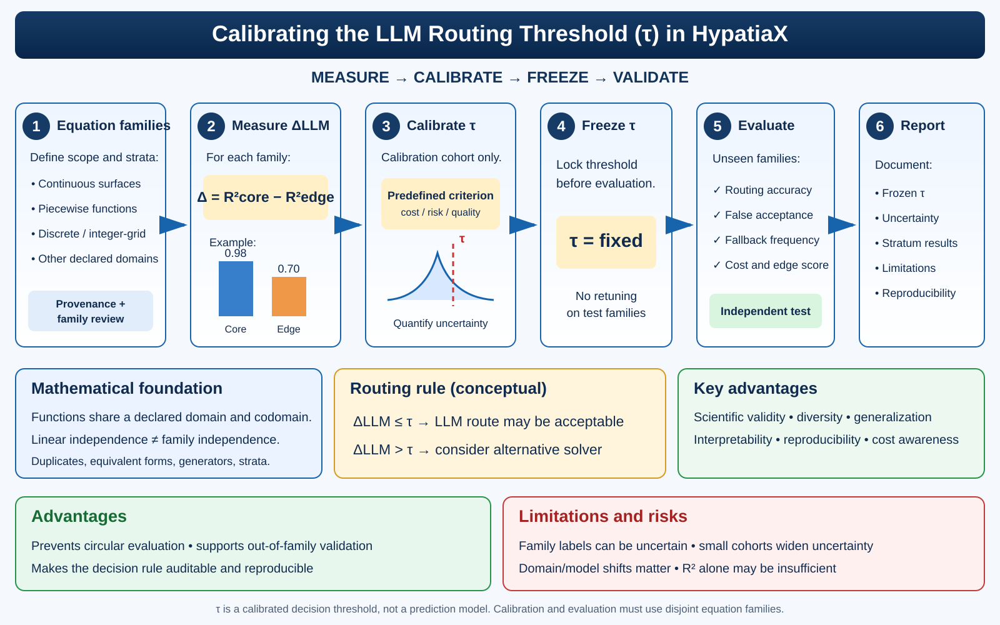

# Methodology for Calibrating the LLM Routing Threshold (τ) in HypatiaX

**Status:** Method proposal and audit protocol. Tau is currently uncalibrated; this document does not claim an empirically validated threshold.

## Executive summary

HypatiaX uses a routing threshold, τ, to decide when an LLM-generated formula is sufficiently robust to remain on the LLM route and when an alternative solver should be considered. The proposed signal is the loss in LLM formula performance between a core/interpolation region and an edge/extrapolation region:

\[
\Delta_{\mathrm{LLM},i}
=R^2_{\mathrm{LLM,core},i}-R^2_{\mathrm{LLM,edge},i}.
\]

Tau is a **decision threshold**, not a prediction model and not a measure of mathematical distance between equation families. Calibration estimates a threshold from calibration families; a separate prediction/routing process applies it to new problems; independent evaluation tests whether the frozen decision rule generalizes.

## 1. Scope and mathematical population

Each candidate equation is treated as a function \(f_i:D_i\to\mathbb{R}\). A vector-space interpretation is available only after specifying a common domain, codomain, and closure under pointwise operations. The benchmark cohort itself is not automatically a vector space.

Do not conflate:
- exact duplicates or algebraically equivalent formulas;
- linear dependence among functions;
- parameterized instances of one generator;
- shared subexpressions;
- common broad templates;
- statistical or benchmark independence.

A linearly independent set is not automatically a set of statistically independent equation families, and it need not be a complete basis for the function space. The project needs a defensible, diverse equation-family sample—not an unsupported claim of a complete vector-space basis.

Define strata before pooling results: continuous univariate functions, continuous bivariate surfaces, piecewise functions, discrete/integer-grid functions, nonsmooth functions, and any other in-scope classes. A threshold calibrated on one stratum must not automatically be claimed to generalize to another.

## 2. Source and family adjudication

For every candidate, preserve source URL/revision, source ID, formula, variables, input domain, license, and extraction provenance. Normalize expressions and perform exact duplicate checks, safe symbolic canonicalization, and reviewed algebraic-equivalence checks. Numerical sampling is useful for triage but is not proof of symbolic equivalence.

Classify relationships explicitly: exact duplicate; proven equivalence; linear dependence; supported common generator/parameterization; shared subexpression only; structurally distinct; or unresolved. Keep parser failures and unresolved cases visible. Do not assign family independence merely because formula strings differ or broad template tags differ.

## 3. Cohort construction

Split by adjudicated equation family, not by individual rows or random point samples:
- **Calibration cohort:** used to measure degradation and select τ.
- **Evaluation cohort:** held untouched until τ and the evaluation protocol are frozen.

Keep known variants, duplicates, and related family members in the same cohort. Record the manifest, source provenance, exclusion reasons, and any uncertain assignments. The family split must precede model evaluation to prevent leakage.

## 4. Measuring LLM degradation

Freeze and record the LLM/model version, prompt, decoding settings, formula-generation protocol, and preprocessing. Generate the formula without access to edge labels. Evaluate the same frozen formula on predeclared core and edge partitions.

For family \(i\):

\[
\Delta_i=R^2_{\mathrm{LLM,core},i}-R^2_{\mathrm{LLM,edge},i}.
\]

Positive values indicate degradation; negative values indicate better edge performance. Preserve finite-score checks, failed generations, negative R² values, and formula-validity outcomes. Do not silently drop difficult families. Record the held-out LLM formula score separately from the selected fallback predictor's score; these are different quantities.

R² should be accompanied by suitable error metrics (for example RMSE and a scale-aware/normalized error) because R² can be unstable when target variance is small or distributions differ substantially between core and edge.

## 5. Selecting and freezing τ

Choose the threshold using calibration data only and a criterion specified before evaluation. Possible criteria include:
- maximum tolerated edge degradation;
- minimum required edge-region quality;
- target safe-LLM-route rate;
- cost-sensitive trade-off between accepting an inadequate LLM solution and invoking an alternative solver unnecessarily.

If costs differ, make them explicit. Let \(C_{\mathrm{fail}}\) denote the cost of accepting an inadequate LLM route and \(C_{\mathrm{fallback}}\) the cost of unnecessary fallback. Optimize the predefined decision objective rather than choosing τ after inspecting evaluation outcomes.

Report the number of independent calibration families, degradation distribution, selected criterion, sensitivity analyses, and uncertainty (for example, family-level bootstrap intervals where justified). Small or heterogeneous cohorts may yield unstable thresholds.

Once chosen, freeze τ and its model/prompt/protocol context. The threshold is not a universal constant.

## 6. Routing and independent evaluation

Conceptually:

\[
\Delta_{\mathrm{LLM}}\leq\tau
\Rightarrow \text{LLM route may be acceptable},
\qquad
\Delta_{\mathrm{LLM}}>\tau
\Rightarrow \text{consider an alternative solver}.
\]

This rule is subject to formula validity, quality gates, and abstention policy. The alternative solver must itself be evaluated; avoiding the LLM is not automatically success.

Apply the frozen rule to previously unseen evaluation families. Report routing accuracy, false acceptance of inadequate LLM solutions, unnecessary fallback rate, edge performance, overall cost, and results by mathematical stratum. Do not retune τ on this evaluation cohort. If recalibration is necessary, designate a new calibration population and preserve a new untouched evaluation population.

## 7. Advantages

1. **Scientific validity:** separates threshold selection from claims of generalization.
2. **Reduced leakage:** family-level splits prevent close variants appearing on both sides.
3. **Interpretability:** the degradation signal has a direct core-versus-edge meaning.
4. **Reproducibility:** frozen formulas, model settings, source revisions, and manifests make the result auditable.
5. **Cost-aware decisions:** the threshold can reflect the relative consequences of routing errors.
6. **Extensibility:** new sources and mathematical strata can be added under explicit rules.

## 8. Limitations and risks

1. **Family adjudication is difficult:** symbolic difference does not prove generator or statistical independence.
2. **Limited sample size:** many formulas may represent few independent families; small cohorts widen uncertainty.
3. **Domain dependence:** continuous-surface results do not automatically transfer to discrete or piecewise tasks.
4. **Model dependence:** model, prompt, decoding, or preprocessing changes can shift the degradation distribution and require recalibration.
5. **Metric limitations:** R² alone can be misleading; report complementary errors and validity.
6. **Threshold sensitivity:** different cost functions and safety requirements imply different thresholds.
7. **Solver dependence:** fallback quality must be measured independently.
8. **Distribution shift:** deployment populations may differ from both calibration and evaluation cohorts.

## 9. Current repository evidence and status

The current audit trail includes:
- a pinned registry of 128 SurfaceBench explicit-surface entries;
- one normalized exact-duplicate pair, NACS1/TECS7;
- a second-pass review of eight identified shared-template groups;
- a provenance review of EBS2 and PTM5, which share a subexpression but have no demonstrated common parameterized generator;
- recovery of four missing historical cohort formulas;
- an identified overlap between historical Incremental VaR and Core-15 Portfolio Standard Deviation through a shared covariance-quadratic risk core.

These are meaningful screening and adjudication results, not proof of complete pairwise symbolic equivalence or statistical independence. Canonical family IDs, independence decisions, and disjoint cohort assignments remain unresolved. A quick tag-overlap count is triage only; broad tags do not establish family equivalence.

**No valid τ value is established by this audit.** The required LLM core/edge measurements and independent cohorts have not yet been completed. In particular, an NN-trained extrapolation/degradation probe must not be substituted for \(\Delta_{\mathrm{LLM}}\). Keep the LLM degradation field unavailable/null and the status explicitly uncalibrated until valid measurements exist.

## 10. Recommended gated workflow

| Phase | Work | Acceptance artifact |
|---|---|---|
| 1 | Define scope and strata | Function-space/benchmark specification |
| 2 | Pin candidate sources | Provenance registry |
| 3 | Normalize and compare formulas | Symbolic adjudication with unresolved cases |
| 4 | Review family and historical/Core-15 overlap | Family registry |
| 5 | Split by family | Frozen disjoint cohort manifest |
| 6 | Freeze model protocol and generate formulas | Formula artifacts and configuration |
| 7 | Evaluate core and edge | Per-family LLM degradation records |
| 8 | Select τ on calibration only | Calibration report and frozen threshold |
| 9 | Apply frozen τ to unseen families | Routing predictions |
| 10 | Evaluate without retuning | Independent evaluation report |

Do not launch expensive experiments or paid model calls until the source/family, cohort, R² policy, workflow-contract, and relevant regression gates have passed and the user has explicitly approved the run.

## 11. Research notes and interpretation safeguards

- **Tau is not “trained and predicted” in the same sense as a model.** Tau is calibrated from data and then used as a fixed decision boundary. A separate predictor may estimate degradation for a new task; that predictor also needs its own leakage-safe training/evaluation design.
- **Avoid circularity:** calibrate on cohort A, freeze τ, evaluate on cohort B. Never tune τ in response to cohort B and then report B as independent validation.
- **Do not call the cohort a complete vector basis** unless a precise function space and spanning proof are supplied. The operational target is an independently adjudicated equation-family population.
- **Do not substitute NN degradation for LLM degradation.** They are different predictors and answer different questions.
- **Separate score semantics:** formula-level LLM held-out R² is not the same as the selected fallback model's held-out R².
- **Keep fail-closed behavior:** until calibration is valid, τ remains unavailable; do not invent a value.
- **Recalibration:** model or prompt changes can invalidate the old threshold. Version the calibration artifact and retain the old evaluation record.

## 12. Conclusion

Tau calibration is a scientific protocol, not merely a numerical tuning exercise. Its credibility depends on defining the population, adjudicating equation families, measuring frozen LLM formula degradation, selecting a threshold under a predefined objective, and validating that frozen threshold on independent families.

**Calibrate on one population, freeze τ, and evaluate on another.** Only then can HypatiaX make a defensible claim that its routing threshold generalizes to unseen mathematical equation families.
