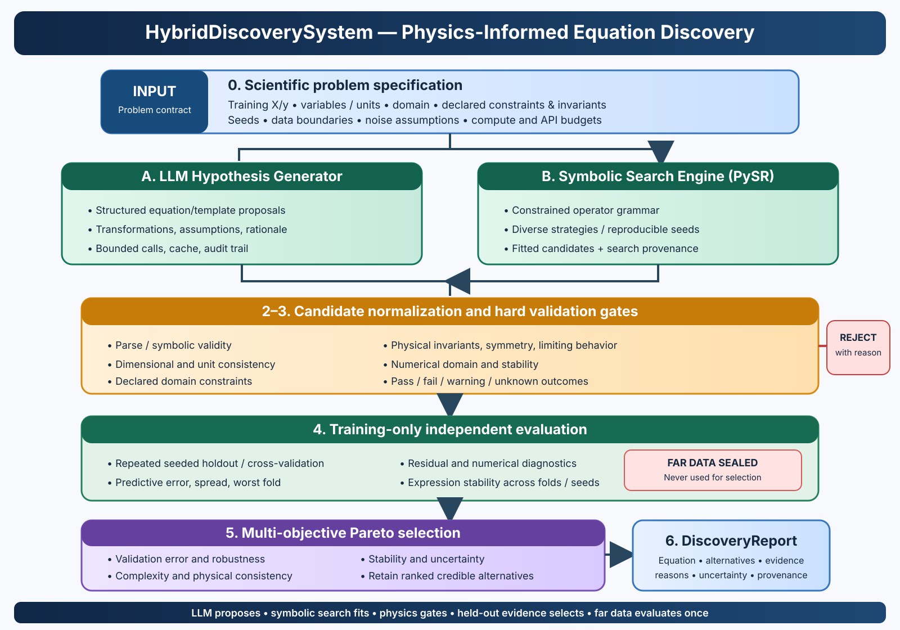

# HybridDiscoverySystem: Physics-Informed Architecture Redesign

**Status:** living architecture and implementation record; the target pipeline is partially implemented.  
**Related implementation:** [PR #177](https://github.com/sednabcn/LLM-HypatiaX-REPRO/pull/177) and subsequent HybridDiscovery implementation PRs through the stability-aware Pareto work.  
**Scope:** architecture, scientific requirements, interfaces, validation policy, implementation status, rollout, and open decisions. Target behavior is distinguished from the implementation record below.



## 1. Executive summary

The current `HybridDiscoverySystem` is closer to a symbolic-regression retry wrapper than a complete physics-informed equation-discovery system. Its recent lifecycle and complexity-aware selection fixes (PR #177) are useful first steps, but selection still relies mainly on training (R^2) plus a heuristic complexity screen. It does not yet establish generalization through independent training-only validation, enforce a comprehensive scientific problem contract, or systematically compare physical plausibility and stability.

The proposed system is a staged, auditable pipeline:

1. Specify the scientific problem and the assumptions that are actually known.
2. Generate hypotheses using bounded LLM assistance and/or domain templates.
3. Search and fit candidates using symbolic regression.
4. Normalize candidates and apply hard symbolic, dimensional, domain, physical, and numerical gates.
5. Evaluate surviving candidates using repeated, seeded validation splits drawn only from the training region.
6. Select and retain a Pareto set across predictive performance, simplicity, physical consistency, and stability.
7. Evaluate the selected model once on the sealed far-extrapolation region, without feeding that result back into discovery or selection.
8. Return a structured report including alternatives, evidence, uncertainty, limitations, and provenance.

**Core principle:** LLM proposes; symbolic search fits; explicit scientific validators gate; held-out training evidence selects; far data evaluates once.

## 2. Current-state diagnosis

### 2.1 Current behavior

The existing implementation has a retry loop around the symbolic engine. It records candidate expressions and quality checks, selects a candidate primarily using training (R^2), and can fall back to `PhysicsAwareRegressor`. PR #177 improves this by keeping the LLM engine alive across retries, excluding invalid/sentinel results, preferring candidates that pass the current complexity screen, and using simplicity as a tie-break.

### 2.2 Remaining architectural gaps

| Gap | Consequence | Required redesign |
|---|---|---|
| Training fit is the main selection signal | High training fit can reward overfit or unstable equations | Repeated internal validation using training-region data only |
| Complexity is a heuristic warning/gate | A heuristic alone is not a scientific validity test | Explicit complexity objective plus separate scientific gates |
| Physical constraints are not a complete contract | Dimensionally valid expressions can still violate physics | Declare hard constraints, soft diagnostics, and unknown assumptions |
| Retry attempts can be near-duplicates | Compute/API budget is spent without meaningful search diversity | Strategy-aware search portfolio and duplicate detection |
| LLM role and cost are not sufficiently bounded | Retries can imply repeated model calls and opaque provenance | Separate proposal stage, cache/deduplicate, explicit call budget |
| One winner hides trade-offs | A slightly better fit can dominate a simpler, more stable model | Preserve a ranked Pareto set |
| Failure can be conflated with weak success | A poor candidate may appear as a discovered equation | Explicit no-credible-candidate outcome and rejection reasons |
| Far-set handling is easy to misuse | Repeated inspection can leak test information into selection | Sealed final evaluation boundary and provenance assertions |

## 3. Target architecture

See the architecture image above. The conceptual stages are:

### Stage 0 — DiscoveryProblem contract

Represent the scientific task explicitly rather than passing disconnected dictionaries through the pipeline.

Proposed fields:

- Target and independent-variable names, descriptions, and canonical units.
- Training data and immutable split metadata.
- Domain identifier and domain-specific assumptions.
- Variable domains and bounds (positive, non-negative, bounded, probability, etc.).
- Hard physical constraints and soft scientific expectations.
- Known invariants, symmetries, conservation laws, monotonicity, and limiting behavior where justified.
- Allowed symbolic operators and forbidden operations.
- Noise assumptions, tolerances, and measurement precision.
- Reproducibility seed, software/configuration versions, and compute budgets.
- Explicit boundary marking the far-extrapolation data as evaluation-only.

Unknown assumptions must remain unknown. Do not infer positivity, conservation, monotonicity, or a physical law solely from variable names. Every constraint should carry its source, severity, applicability, and evidence.

### Stage 1 — Hypothesis generation

The LLM is a hypothesis generator, not an authority or final selector.

It may produce structured proposals containing:

- Candidate expression or expression template.
- Expected operator families and transformations.
- Physical rationale and assumptions.
- Expected dimensions and limiting behavior.
- Confidence and known caveats.
- A traceable proposal identifier.

Controls:

- Bound the number of calls, tokens, latency, and retries.
- Cache or deduplicate equivalent proposals.
- Record requested/actual model mode, call status, replay status, errors, and sanitized provenance.
- Treat malformed or unsupported proposals as rejected inputs.
- Never allow LLM confidence to override hard validators or measured evidence.
- Provide a deterministic non-LLM route.

A proposal should be converted into a constrained search hint, not accepted as a fitted result. The system should make clear whether a candidate originated from an LLM proposal, a domain template, an unconstrained search, or a hybrid search.

### Stage 2 — Symbolic candidate search

Run a portfolio of meaningfully different search strategies rather than merely repeating the same search with a new seed.

Potential strategies:

- LLM-proposed operator/template seeds.
- Domain-template or invariant-derived seeds.
- Constrained PySR search with explicit grammar.
- Alternative operator subsets or complexity budgets.
- Residual-guided search to model unexplained structure.

Each strategy must have an explicit resource budget and reproducible seed. Search attempts should be deduplicated by normalized symbolic form. Candidate generation must be separated from candidate evaluation and final selection.

### Stage 3 — Candidate normalization and hard validation gates

Normalize expression syntax and variable naming before evaluation. Retain the original expression for audit.

Hard gates should be applied in a traceable order:

1. Parseability and supported symbolic operations.
2. No undefined variables, sentinel expressions, or non-finite constants.
3. Dimensional consistency using canonical units and explicit unit metadata.
4. Domain restrictions, including singularities and invalid input regions.
5. Numerical safety: finite outputs, no unintended overflow/underflow, and controlled behavior near singularities.
6. Explicit physical constraints supplied by the problem contract.

Physical checks may include, where scientifically justified:

- Positivity or non-negativity.
- Conservation/invariant residuals.
- Symmetry or exchange invariance.
- Monotonicity over a declared domain.
- Limiting/asymptotic behavior.
- Boundary conditions.
- Sign and range constraints.
- Known structural identities.

A constraint evaluator must distinguish:
- **pass** — the candidate was checked and passed;
- **fail** — the candidate violated a hard requirement;
- **warning** — a soft expectation is questionable;
- **not_applicable** — the check does not apply;
- **unknown/not_checked** — evidence or metadata was unavailable.

Do not silently convert warnings into passes. Do not penalize a candidate for a physical law that was never declared. A candidate that fails a hard constraint is ineligible for selection, with a machine-readable rejection reason.

The existing `EnsembleValidator`, `DimensionalValidator`, `DomainValidator`, and `SymbolicValidator` should be audited and reused where their semantics are sound. Their aggregate score must not substitute for inspectable per-check results.

### Stage 4 — Training-only evaluation

All model fitting and candidate selection must use data from the training region. Divide that region into reproducible fitting/validation partitions.

Recommended evaluation:

- Repeated seeded holdouts or cross-validation appropriate to sample size.
- Range-aware splits where the scientific question requires testing interpolation near the edge of the observed domain.
- Fit every candidate only on each fold's fitting partition.
- Evaluate on that fold's held-out training-region partition.
- Record mean, median, spread, worst-fold behavior, and valid-fold count.
- Record residual structure, heteroscedasticity indicators, and numerical failures.
- Measure expression stability across folds and seeds, including symbolic equivalence where feasible.

Do not use the far-extrapolation set for early stopping, hyperparameter tuning, operator selection, LLM prompting, candidate filtering, tie-breaking, or retry decisions.

If the available training sample is too small for reliable repeated validation, report that limitation and use a predeclared alternative (for example, leave-one-out where appropriate). Never present an unstable estimate as strong validation evidence.

### Stage 5 — Multi-objective selection

First apply hard eligibility gates. Then compare eligible candidates across distinct objectives:

- Predictive error on internal held-out training data (scale-normalized and with units/scale stated).
- Variability/worst-fold performance.
- Symbolic complexity (node count, operator cost, nesting, and/or description length).
- Physical consistency and soft-constraint diagnostics.
- Stability across splits/seeds and sensitivity to perturbations.
- Numerical robustness over the declared valid input domain.

Use Pareto dominance to preserve meaningful trade-offs rather than hiding all objectives inside one opaque weighted score. If a single recommendation is needed, use a documented, predeclared tie-break policy and retain the full Pareto set.

Do not compare raw errors across differently scaled targets without normalization. Keep metric definitions, units, null semantics, and lower/higher-is-better direction explicit.

### Stage 6 — Sealed far-extrapolation evaluation

The far region is a final evaluation set. It is not part of candidate discovery.

- Freeze the candidate set, selection policy, and selected equation before far evaluation.
- Evaluate the selected candidate and, if useful for reporting, the already-frozen Pareto alternatives.
- Do not use far metrics to revise the selected model or rerun discovery.
- Record far metrics as evaluation outputs only.
- Mark the run as contaminated if far data was used in any selection decision.

For Exp2, preserve the normalized score contract already introduced: `extrapolation_score = RMSE_far / std(y_train)`, with explicit null/status behavior when training target scale is invalid or zero. Keep legacy `error_pct` clearly marked as legacy and never use it for selection.

### Stage 7 — DiscoveryReport

Return a structured report rather than only an expression and training (R^2).

Suggested report fields:

- `status`: `accepted`, `provisional`, or `no_credible_candidate`.
- Selected equation and normalized symbolic representation.
- Ranked/Pareto candidate alternatives.
- Candidate source and search strategy.
- Hard-gate outcomes and rejection reason codes.
- Per-objective metrics, units, folds, spread, and valid sample counts.
- Complexity and stability diagnostics.
- Physical assumptions, checks applied, checks not applicable, and unknowns.
- Residual and numerical diagnostics.
- LLM provenance and call-budget accounting.
- Seeds, config, engine versions, and software provenance.
- Training-only selection evidence.
- Separate final far-evaluation metrics and an explicit flag that they were not used for selection.
- Limitations and confidence statement.

If no candidate passes the hard gates or the predeclared minimum evidence requirements, return `NO_CREDIBLE_CANDIDATE`. A low-quality expression may be retained as a diagnostic artifact, but must not be represented as a successful discovery.

## 4. Suggested component boundaries

These are conceptual responsibilities, not claims that the classes already exist.

| Component | Responsibility |
|---|---|
| `DiscoveryProblem` | Immutable scientific/data contract, units, constraints, budgets, split boundaries |
| `HypothesisGenerator` | Bounded LLM and template-based structured proposals |
| `CandidateSearch` | PySR/search portfolio, seeds, strategy tracking, duplicate detection |
| `CandidateNormalizer` | Canonical parse/representation and expression identity |
| `PhysicsConstraintEvaluator` | Hard constraints and soft scientific diagnostics |
| `CandidateEvaluator` | Training-only folds, predictive/stability/residual metrics |
| `ParetoSelector` | Eligibility, Pareto front, transparent final tie-break |
| `DiscoveryReport` | Full result, alternatives, audit trail, uncertainty, final test metrics |

Suggested candidate record:

```python
{
    "candidate_id": "...",
    "expression": "...",
    "normalized_expression": "...",
    "source": "llm_proposal|domain_template|pysr_search|residual_search",
    "search_strategy": "...",
    "seed": 42,
    "hard_constraints": {
        "dimensional_consistency": {"status": "pass"},
        "domain_validity": {"status": "pass"},
        "physical_invariants": {"status": "unknown"},
        "numerical_safety": {"status": "pass"}
    },
    "training_validation": {
        "metric_name": "...",
        "fold_scores": [],
        "mean": None,
        "spread": None,
        "worst_fold": None
    },
    "complexity": {"node_count": None, "operator_cost": None},
    "stability": {"equivalent_across_folds": None},
    "eligible": False,
    "rejection_reasons": []
}
```

Exact schemas should be settled during implementation and versioned for benchmark compatibility.

## 5. Selection policy and safeguards

Recommended order:

1. Reject malformed, unsupported, non-finite, or sentinel candidates.
2. Reject candidates that violate a declared hard constraint.
3. Require a minimum amount of valid training-only validation evidence.
4. Compute predictive, complexity, physical, and stability objectives independently.
5. Construct the Pareto set.
6. Apply a documented tie-break only if a single default equation is required.
7. Freeze selection before any far-set evaluation.

The current PR #177 policy (prefer candidates that pass the existing complexity screen, then training (R^2), with a simplicity tie-break) remains a transitional improvement, not the target final selection policy.

## 6. Reproducibility, budgets, and provenance

Every run should record:

- Input-data fingerprint or stable dataset identifier (without exposing sensitive data).
- Training/far split definition and split seed.
- DiscoveryProblem version and constraint-source metadata.
- Search engine/version/configuration, operator grammar, and per-strategy seeds.
- LLM provider/model/mode, whether a call was attempted/completed/replayed, proposal IDs, and sanitized error details.
- LLM call/token/latency budget and actual usage where available.
- Candidate counts at each stage and rejection counts by reason.
- Fold definitions, validation metrics, selector version, and tie-break policy.
- Final selected candidate ID and immutable candidate-set fingerprint.
- Far evaluation timestamp/stage and explicit `used_for_selection: false`.

Retries should be budgeted by total search cost, not merely attempt count. A timeout should not automatically trigger another equivalent expensive search. LLM proposals should be cached/deduplicated where safe; the number of LLM calls should be an explicit configuration, not an accidental consequence of retry count.

## 7. Failure states

Use explicit outcomes, for example:

- `INVALID_PROBLEM_SPECIFICATION`
- `NO_CANDIDATES_GENERATED`
- `ALL_CANDIDATES_FAILED_SYMBOLIC_VALIDATION`
- `ALL_CANDIDATES_FAILED_PHYSICAL_GATES`
- `INSUFFICIENT_VALIDATION_EVIDENCE`
- `NO_CREDIBLE_CANDIDATE`
- `SEARCH_BUDGET_EXHAUSTED`
- `LLM_UNAVAILABLE_FALLBACK_USED`
- `ACCEPTED_WITH_WARNINGS`
- `ACCEPTED`

Failure should preserve candidate and diagnostic artifacts where possible, but it must not silently downgrade into a success state.

## 8. Testing strategy (CI only)

Tests should be offline and deterministic. No live LLM calls, worker launches, benchmark runs, or external API calls should be required for ordinary regression coverage.

Recommended test layers:

1. **Unit tests:** expression normalization, candidate identity, constraint result semantics, dimensional checks, Pareto dominance, tie-break determinism, null/invalid metric handling.
2. **Scientific synthetic tests:** known equations with known units, invariants, symmetries, limiting behavior, and deliberately invalid alternatives.
3. **Leakage tests:** prove that far-set values cannot affect candidate ranking, early stopping, prompt content, or selector output.
4. **Validation tests:** repeated splits are deterministic under fixed seeds; fold metrics aggregate correctly; insufficient sample cases are explicit.
5. **LLM contract tests:** mocked proposal responses, unavailable provider, malformed proposal, duplicate proposals, call-budget enforcement, and deterministic non-LLM fallback.
6. **Provenance tests:** every candidate has source/strategy/seed and every rejection has a reason.
7. **Integration tests:** end-to-end synthetic pipeline with mocked search/LLM components and no network or worker execution.
8. **Exp2 compatibility tests:** preserve existing row-level audit artifacts and normalized extrapolation score semantics.

CI must be the execution venue. Do not add experiment or smoke workflow launches as part of this documentation change.

## 9. Migration plan

### Phase A — Contracts and auditability
- Define versioned `DiscoveryProblem`, candidate, constraint-result, and report schemas.
- Preserve the current public `discover()` interface through an adapter.
- Add candidate IDs, source/strategy metadata, and explicit failure statuses.
- Keep PR #177 lifecycle/complexity fixes intact.

### Phase B — Independent training validation
- Implement seeded internal folds and candidate-level validation.
- Add leakage guards that make far data inaccessible to the selector.
- Record predictive spread, worst-fold metrics, and stability.
- Keep current selector behind a versioned compatibility option during migration.

### Phase C — Physics-informed gates
- Compose existing validators through typed per-check outcomes.
- Add domain-specific constraints only when declared in the problem contract.
- Add synthetic tests for dimensional and physical counterexamples.
- Separate hard failures from soft warnings and unknown checks.

### Phase D — Pareto selection and report
- Implement multi-objective Pareto ranking.
- Retain alternatives and transparent tie-break rationale.
- Add `NO_CREDIBLE_CANDIDATE` and structured report output.
- Keep legacy benchmark fields available while adding versioned fields.

### Phase E — Search and LLM orchestration
- Separate proposal generation from search attempts.
- Add bounded/cached LLM proposals and total budget accounting.
- Add strategy-aware search diversity and duplicate detection.
- Make pure symbolic fallback deterministic and auditable.

### Phase F — Scientific evaluation (only when explicitly authorized)
- After implementation and CI review, run approved synthetic/benchmark experiments.
- Compare the redesigned selector against the historical baseline.
- Evaluate interpolation and far extrapolation separately.
- Report per-equation/direction coverage and all failed/invalid cases.
- Do not launch these experiments without explicit authorization.

## 10. Non-goals and scientific caveats

- This architecture does not guarantee discovery of the true governing equation.
- Dimensional consistency is necessary in many physical settings but is not sufficient for physical correctness.
- A candidate can satisfy known constraints and still be wrong outside the observed domain.
- LLM-generated rationales are hypotheses, not evidence.
- Pareto optimality is relative to the objectives and candidate pool; it does not establish truth.
- Extrapolation performance is empirical evidence on the evaluated range, not a proof of behavior at arbitrary distances.
- Domain-specific constraints must be supplied and reviewed by someone with appropriate scientific knowledge.
- The redesign must not optimize repeatedly against the far set.

## 11. Repository integration notes

- PR #177 is the implementation baseline for LLM lifecycle persistence and the interim complexity-aware selector.
- This document is a design specification only; it does not alter the runtime behavior.
- The Exp2 normalized score contract remains: `extrapolation_score = RMSE_far / std(y_train)`, with explicit status/null semantics.
- Keep legacy `error_pct` for compatibility but do not promote it as the primary score.
- Keep REPRO responsible for reproducible experiment sources/workers. Any post-run comparative analysis belongs in DEV.
- No experiments, smoke runs, workers, benchmarks, LLM API calls, or tests are launched by this documentation change.

## 12. Acceptance criteria for the future implementation

The redesign should not be considered complete until:

- [ ] Problem assumptions, units, domains, and constraints are explicit and versioned.
- [ ] Candidate provenance and rejection reasons are complete.
- [ ] Hard physical/dimensional/domain checks are separate from soft diagnostics.
- [ ] Candidate selection uses repeated training-only validation, not training fit alone.
- [ ] The far set is inaccessible to selection and leakage tests prove this.
- [ ] Candidate selection is multi-objective and retains a Pareto set.
- [ ] LLM usage has explicit budgets, deduplication, and a deterministic fallback.
- [ ] No-credible-candidate is a first-class outcome.
- [ ] Offline CI tests cover contracts, scientific constraints, stability, leakage, and provenance.
- [ ] Benchmark outputs preserve the Exp2 normalized score contract.
- [ ] No claim of scientific improvement is made until authorized experiments provide evidence.


---

## 13. Implementation log — candidate validation gates

This section records the implementation sequence and the boundary between completed code and remaining architecture work. It supplements the target design above; it does not claim that the full redesign is complete.

### 13.1 Step 1 — typed problem and candidate contracts

The implementation uses the existing versioned contracts in `hypatiax/tools/symbolic/discovery_contracts.py`:

- `DiscoveryProblem` carries target identity/unit, variable names/units/domains, declared constraints, operator allowlists, split protocol, budget, and metadata.
- `ConstraintSpec` declares a constraint identifier, kind, severity, and parameters.
- `ConstraintOutcome` records pass/fail/warning/not-applicable/unknown/not-checked, severity, reason, and evidence.
- `CandidateRecord` carries normalized expression, source, search strategy, seed, constraint outcomes, rejection reasons, eligibility, and deterministic candidate identity.
- `DiscoveryReport` is the intended structured report envelope, including selected and Pareto candidate identifiers and a segregated far-evaluation field.

The contracts are explicit: no unit, positivity, symmetry, or physical law is inferred from a variable's spelling. Callers must supply the scientific assumptions they want enforced.

### 13.2 Step 2 — standalone candidate validator

Added `hypatiax/tools/symbolic/discovery_validation.py` and exported `CandidateValidator` from the symbolic package.

The validator performs these gates:

1. Restricted mathematical parsing using the repository's safe SymPy parser.
2. Rejection of invalid and non-finite symbolic expressions.
3. Dimensional analysis through the existing `DimensionalValidator` when units are declared, including comparison with the declared target unit.
4. Explicit domain checks for `positive_output`, `nonnegative_output`, and `finite_output`.
5. Explicit even/odd symmetry checks for a named variable, only when the declared sampling interval is symmetric about zero.
6. Auditable per-check outcomes and rejection reasons.

Domain checks use a deterministic Cartesian grid built from declared finite variable bounds, capped by `sample_limit` (default 512). This is a screening test, not a proof over a continuous domain. A hard constraint that cannot be evaluated is `unknown` and blocks eligibility; missing evidence never silently passes a hard gate. Unsupported constraint kinds are also unknown rather than guessed.

When no units or constraints are declared, the corresponding built-in checks are marked `not_applicable`. This preserves a clear distinction between “checked and passed” and “not specified.”

### 13.3 Step 3 — offline regression coverage

Added `tests/test_physics_informed_candidate_validation.py` with cases for:

- A declared nonnegative-output constraint passing and being recorded.
- A strict-positive constraint rejecting a zero boundary.
- An unevaluable hard constraint producing unknown and blocking eligibility.
- An unsafe/untrusted expression being rejected by the restricted parser.

Also added `tests/test_hybrid_candidate_gate_integration.py` to exercise the retry boundary with a controlled fake symbolic engine: a candidate passing a declared hard gate can be selected, while a candidate failing a hard gate cannot be returned as a discovery. These are offline unit tests; they do not instantiate PySR or call an LLM.

These tests were added to the repository but were not run locally by the implementation agent. No CI run is implied by their presence.

### 13.4 Step 4 — connect gates to live retry selection

The next integration change is in `hypatiax/tools/symbolic/hybrid_system_v50_2.py`.

- The public `discover(..., metadata=...)` adapter accepts an optional typed `metadata["discovery_problem"]` value.
- The value must be a `DiscoveryProblem` instance. A plain dictionary is rejected rather than being guessed/coerced into scientific assumptions.
- The active problem is reset on every public call, preventing a reused engine from accidentally carrying one equation's constraints into the next.
- Each valid PySR retry candidate is passed through `CandidateValidator` before it can enter the clean or complexity-flagged selection pools.
- Failed or unknown hard gates exclude the candidate from selection and are attached to the attempt result as `candidate_validation` and `candidate_validation_status`.
- Early stopping is permitted only for a candidate that passes the declared gates.
- The optional PhysicsAwareRegressor fallback is subjected to the same declared gates before it can replace the symbolic result.
- If every candidate fails a configured hard gate, no rejected candidate is promoted as a valid discovery.

The existing complexity heuristic remains a secondary preference after scientific eligibility. Training R² remains the interim score within the eligible pool. Far/test metrics are not passed to the validator and are not used by this gate or retry selection.

**Compatibility mode:** If `discovery_problem` is omitted, the legacy retry path remains active and candidate validation is marked `not_configured`. This is deliberate during migration: old benchmark callers have not yet been updated to supply complete units/domains/constraints. A run without a problem contract must not be described as having passed physics-informed gates.

### 13.5 Current limitations after this integration

- Candidate validation is opt-in until benchmark and application callers construct and pass a complete `DiscoveryProblem`.
- The validator currently implements only the listed built-in constraint kinds. Conservation laws, invariants, limiting behavior, monotonicity, and more advanced domain predicates require explicit typed extensions and tests.
- Deterministic finite-grid checks can miss violations between sample points and can reject a valid candidate if a sampled point lies on a singularity. Evidence must always state the sampling protocol.
- Dimensional analysis depends on the existing validator's supported unit grammar and inference behavior. An unknown or missing required unit result blocks a declared hard dimensional gate.
- The retry selector still uses the existing training-R²/complexity policy among candidates that pass gates. Repeated held-out training validation, expression stability, and Pareto selection are not implemented by this step.
- The report envelope is not yet the sole public return format; legacy result dictionaries remain for compatibility.
- The far set remains outside this implementation path. A separate evaluation-only adapter is still needed to make the “sealed far set” boundary architectural rather than merely a caller convention.

### 13.6 Next implementation steps

1. Update REPRO benchmark adapters to construct typed `DiscoveryProblem` instances from authoritative equation metadata, units, ranges, and reviewed constraints; do not invent constraints where metadata is absent.
2. Add training-only repeated/blocked holdout evaluation and leakage tests. The selector must receive training folds only; the far set must not be present in its function signature.
3. Record candidate predictions and fold-level evidence, then measure expression stability across seeds/folds.
4. Add additional declared physical predicates (invariants, symmetry groups, limiting cases) with explicit unknown/fail semantics and counterexample tests.
5. Implement multi-objective Pareto ranking over validation error, complexity, physical consistency, and stability, retaining alternatives and rationale.
6. Produce `DiscoveryReport` as the structured result while preserving legacy fields during migration.
7. Add CI-only regression coverage and inspect CI results before any experiment is considered.
8. Only after the implementation and CI review, request explicit authorization before launching any smoke, benchmark, worker, or LLM-backed experiment.

### 13.7 Change provenance

- Candidate validation module and tests were introduced in PR #180, which GitHub reports merged into the #177 implementation branch.
- Retry/fallback integration, integration regression tests, and this documentation update are being developed as the next stacked implementation change on the #177 branch.
- PR #177 remains the implementation baseline until merged to `master`; PR #178 contains the original architecture specification and remains a separate documentation PR at the time of this update.
- No experiment, smoke workflow, benchmark, worker, local test, CI workflow, or LLM API call was launched for these implementation changes.


---

## 14. Implementation log — training-only repeated validation primitives

This step implements the reusable validation substrate described in Stage 4. It does not yet replace the retry loop's transitional training-R² selector; integration is intentionally deferred until the symbolic engine can refit candidate constants independently inside each fold.

### 14.1 Step 1 — sealed input boundary

Added `hypatiax/tools/symbolic/training_validation.py`.

The public evaluator accepts only:
- `X_train` and `y_train`, representing the already isolated training region;
- an explicit collection of fold indices relative to those arrays;
- a fold-aware predictor callback with the signature `(X_fit, y_fit, X_validation) -> predictions`.

There is no far/test argument, no far-data accessor, and no callback argument through which a caller can pass the far set. The callback receives only the current fitting partition and the corresponding held-out validation features. Candidate fitting/constant estimation must occur inside that callback using `X_fit` and `y_fit` only.

The utility checks that fitting and validation indices are disjoint, in range, and partition the supplied training rows. It rejects non-finite training arrays and invalid prediction shapes/values. A failed fold is counted; insufficient valid folds raise an explicit error rather than silently producing a partial score.

This is a structural boundary for this API, not a security sandbox: a malicious or incorrectly written closure could still capture external data. The caller contract and regression tests must therefore remain explicit.

### 14.2 Step 2 — deterministic fold generation

Added `make_training_folds()` with two declared strategies:

- `repeated_random`: seeded repeated holdouts, deterministic for a fixed sample count and configuration.
- `blocked`: one set of contiguous held-out windows of the configured `validation_fraction`, preserving original row order and training on the complement. This mode requires `n_repeats=1`; repeating identical blocked windows would add no evidence. Use this only when row order represents the scientific/time/range ordering; do not assume ordinary row order is meaningful.

Each fold records repeat/fold identifiers and immutable train/validation index tuples. The implementation validates sample counts, split counts, validation fraction, and strategy. The split indices refer only to the caller's training-region arrays; the helper has no knowledge of the far boundary.

### 14.3 Step 3 — fold metrics and stability evidence

Added `evaluate_candidate_on_training_folds()`, which aggregates:
- RMSE for each held-out training fold;
- fold-normalized RMSE using the standard deviation of that fold's fitting-target values (null when that scale is zero);
- mean RMSE, RMSE spread, worst-fold RMSE, mean available normalized RMSE;
- valid and failed fold counts.

Added `expression_stability()` as a conservative first stability diagnostic across expressions returned by separate folds/seeds. It normalizes whitespace and the `^`/ `**` power spelling only. It deliberately does not claim algebraic equivalence; expressions that are mathematically equivalent but syntactically different remain distinct until a sound canonical symbolic-equivalence policy is implemented.

The public API is lazily exported from `hypatiax.tools.symbolic`.

### 14.4 Step 4 — offline regression source

Added `tests/test_training_only_validation.py` covering:
- deterministic repeated random folds and complete, disjoint partitions;
- contiguous blocked validation ranges;
- fold metric aggregation and fitting-partition target normalization;
- non-finite predictions and insufficient-valid-fold failure;
- transparent expression-stability counting without an equivalence claim.

These tests were added but not executed by this implementation. No local tests, CI workflows, experiments, smoke runs, workers, benchmarks, or LLM API calls were launched.

### 14.5 Important limitation and next integration step

The new utility is a reusable primitive, not yet the active HybridDiscovery selector. The existing PySR result is generally fitted on the complete training array; simply scoring that already-fitted expression on internal folds would leak each fold's held-out targets through fitted constants. This implementation therefore requires a fold-aware refit callback and does not pretend that post-hoc evaluation of a full-training fit is independent validation.

Next, implement a fold-local symbolic refit adapter that:
1. receives only `X_fit/y_fit` for each fold;
2. fits or refits candidate constants without seeing that fold's validation targets;
3. predicts the held-out training fold;
4. returns fold-specific normalized expressions/metrics for stability analysis;
5. supplies training-only validation summaries to candidate selection.

Only after this adapter exists should repeated-validation evidence replace training R² in the retry selector. The far/test array must remain outside every function and object used by that selector. Keep the current selector explicitly transitional until then.

### 14.6 Change provenance

- This implementation is on branch `hybrid/training-only-repeated-validation`, stacked on PR #177's branch after PR #181 merged into that branch.
- It adds a training-only validation module, public lazy exports, offline regression test source, and this implementation log.
- The architecture diagram is unchanged because this step implements an already documented Stage 4 boundary and does not alter the target pipeline topology.
- No test, CI, experiment, smoke, worker, benchmark, or LLM-backed workflow was run.


---

## 15. Implementation log — fold-local symbolic coefficient refitting

This step advances Stage 4 from generic callbacks to a concrete restricted symbolic refit adapter. It deliberately does not wire the adapter into the production retry selector yet; the remaining preprocessing boundary must be made fold-local first.

### 15.1 Step 1 — restricted expression compilation

Added \`make_symbolic_refit_predictor(expression, variable_names)\` to \`training_validation.py\`.

- Expressions are parsed with the repository's restricted \`parse_sympy_expression\` grammar; arbitrary Python evaluation, attribute access, imports, and unapproved calls are not accepted.
- The adapter identifies numeric floating-point literals as candidate coefficients.
- Integer constants and numeric exponents are retained as structure; floating-point exponents are also excluded from coefficient optimization.
- SymPy compiles the parameterized expression to a NumPy evaluator.
- The adapter requires a unique, explicit variable list and checks every fold matrix against that schema.

### 15.2 Step 2 — independent fit inside each fold

Each invocation of the predictor receives exactly \`X_fit\`, \`y_fit\`, and \`X_validation\`. It initializes coefficients from the original expression, then uses SciPy \`least_squares\` to estimate floating-point coefficients against \`X_fit/y_fit\` only. The fitted coefficients are used to predict \`X_validation\`. The validation targets are consumed only later by the metric aggregator, never by the coefficient optimizer.

The new \`evaluate_symbolic_candidate_on_training_folds()\` helper connects this adapter to the deterministic fold evaluator. The per-fold fitted expression is retained in each \`FoldMetric\`; the serialized summary includes conservative expression recurrence across the fold-fitted forms.

This is a refit of numeric coefficients for a fixed symbolic structure. It is not a fresh PySR search per fold, does not refit integer constants or exponents, and does not establish that the chosen symbolic structure would have been discovered independently in every fold.

### 15.3 Step 3 — regression source

Extended \`tests/test_training_only_validation.py\` with regression cases for:
- recovery of a floating-point coefficient using only each fold's fitting rows;
- rejection of an expression containing an attempted Python import;
- extraction of fold-fitted expressions for stability reporting.

The tests are source additions only and have not been run.

### 15.4 Step 4 — why selector integration remains deferred

The active HybridDiscovery path can apply signed-log scaling and the symbolic engine can add engineered/ratio/geometric-mean columns before PySR fitting. Some feature preparation may be data-dependent. The currently retained \`_last_X_aug\` matrix and its names describe the full discovery fit; reusing that matrix in internal folds would not prove that feature preparation was independent of each fold's held-out rows.

Therefore this PR does not connect the adapter to \`_discover_with_retry()\`, does not replace training-R² selection, and does not claim leakage-free end-to-end validation of the current production pipeline. The next required work is a fold-aware preprocessing contract that:
1. learns all data-dependent transformations from each fold's fitting rows only;
2. applies the fitted transform unchanged to that fold's validation rows;
3. preserves a verifiable mapping from raw feature names to engineered feature names;
4. then invokes the coefficient-refit adapter with the fold-specific feature matrices;
5. exposes only the aggregated training-region validation evidence to the selector.

Until that boundary exists, the validation API is opt-in and isolated. No far/test data is accepted by the adapter or helper.

### 15.5 Scientific and numerical limitations

- Optimizing floating-point literals can be non-identifiable when terms are collinear or redundant.
- Nonlinear least-squares can converge to a local minimum; a successful optimizer status is not proof of global optimality.
- Repeated equal floating-point literals are represented as one SymPy atom and therefore share one fitted value in this initial implementation.
- Integer coefficients/exponents are fixed; future support must distinguish structural exponents from fit-able integer coefficients safely.
- The adapter uses unbounded least-squares for coefficients. Physically meaningful coefficient bounds should come from explicit typed scientific metadata, not guessed defaults.
- Expression recurrence is syntactic after conservative formatting; it is not symbolic equivalence.

### 15.6 Change provenance

- Branch: \`hybrid/fold-local-symbolic-refit\`.
- Base: \`hybrid/fix-llm-lifecycle-and-candidate-selection\` (PR #177); PR #182's training-only validation primitives are already present on that base branch.
- Changes: safe symbolic coefficient-refit adapter, fold-specific fitted-expression audit, report stability summary, public exports, regression source, and this documentation update.
- No tests, local execution, CI workflows, experiments, smoke runs, workers, benchmarks, or LLM API calls were launched.


---

## 16. Implementation log — fold-aware raw-feature preprocessing

This step adds a reusable preprocessing primitive for Stage 4. It addresses the first fold-local transformation boundary without claiming that the current symbolic engine's entire feature pipeline is already reproducible inside each fold.

### 16.1 Source audit and leakage boundary

The current symbolic engine performs several data-dependent operations before PySR fitting:

- signed-log feature selection based on per-column range and magnitude;
- extreme-column scaling based on column mean and standard deviation;
- geometric-mean feature creation for selected positive columns;
- ratio feature creation, with positive-column eligibility and a top-10 ranking by ratio variance;
- separate target scaling/normalization and domain/operator heuristics.

The engine stores its final augmented matrix and names after these operations. Reusing that full-discovery matrix in internal folds would carry feature-selection and transformation decisions made with rows that are held out in a fold. Rebuilding only the derived columns from raw inputs would also be insufficient: the ratio ranking and positivity decisions must be learned independently in each fitting partition, and fold-specific feature schemas may no longer match the fixed candidate expression.

### 16.2 New fold-local preprocessor

Added FoldFeaturePreprocessor to training_validation.py.

- Accepts only explicit raw feature names and fitting/transform feature matrices.
- Learns signed-log flags from each fitting column's nonzero range and median magnitude.
- Learns extreme-column scale factors from the signed-log-transformed fitting rows.
- Applies those frozen parameters unchanged to validation rows.
- Preserves the raw feature names and column order; it does not silently add or reorder columns.
- Exposes JSON-friendly audit_state() with selected log columns, scales, and the declared fitting-row scope.
- Rejects non-finite arrays, shape/schema mismatches, and transform-before-fit.

The implementation does not accept target values, validation targets, or far/test data. A validation extreme can be transformed, but cannot change fitted flags or scales.

### 16.3 Regression source

Added offline regression source for:
- fold fitting-row-only transform selection and immutable state after validation transformation;
- deterministic transformed values and stable raw feature-name order;
- rejection of unfitted use and feature-width mismatch.

These tests were added but not run.

### 16.4 Deliberate non-integration and remaining boundaries

This adapter is not yet wired into _discover_with_retry() or the symbolic coefficient-refit helper. The source audit found that production expressions may reference gm_* and ratio_* columns, and the engine also applies target scaling/normalization. The present adapter intentionally does not synthesize those engineered features or guess the target-space mapping. Passing a candidate that references those columns into a raw-feature-only fold matrix would be invalid; silently dropping or recreating them would overstate leakage safety.

The next integration step must introduce a typed, per-fold feature-plan contract that either:
1. makes engineered feature definitions and selection rules explicit and learns all data-dependent choices on each fitting partition, while preserving a valid expression-variable mapping; or
2. marks candidates that depend on unsupported full-data engineered features as ineligible for this validation path.

It must also capture the target transform and symbolic output normalization explicitly, fit those parameters on each fitting partition only, and invert predictions before comparing them with held-out training targets. Only then can fold-local preprocessing and coefficient refitting safely supply selector evidence.

### 16.5 Current status and provenance

- Implemented: fold-local signed-log flag learning, fold-local input scale learning, frozen transform application, stable raw feature schema, and preprocessing audit metadata.
- Not implemented: geometric-mean/ratio feature-plan replay, fold-local target transforms, full engine/PySR refit per fold, retry-selector integration, or Pareto selection.
- No tests, local execution, CI workflows, experiments, smoke runs, workers, benchmarks, or LLM API calls were launched.
- No far/test data was accessed.


---

## 17. Implementation log — fold-local engineered feature plans and target scaling

This step advances the fold boundary from raw columns to the two explicit engineered-feature families used by the symbolic engine, and adds a fold-fitted target scale.

### 17.1 Fold-fitted feature plan

Added the immutable FoldFeaturePlan and FoldFeaturePipeline APIs.

- The pipeline first fits FoldFeaturePreprocessor on the fold's fitting rows.
- Strictly-positive input columns are identified from the transformed fitting partition only.
- Optional geometric-mean features are enumerated as deterministic unordered pairs of eligible positive columns.
- Optional directed ratio features are ranked by standard deviation computed only on fitting rows; ties are resolved by feature names for deterministic schemas, and the configured cap is applied after ranking.
- The resulting plan freezes raw feature order, geometric-mean pairs, ratio pairs, and output names.
- Validation transformation reuses the exact frozen plan and preprocessing parameters. It does not reselect features.
- If a validation row leaves the positive domain required by a selected derived feature, transformation fails closed rather than generating a mathematically misleading feature.

The feature-family switches are explicit inputs. The pipeline does not infer whether optics geometric means or exp-domain ratios should be enabled from the equation name or domain; callers must supply that decision from a declared discovery contract.

### 17.2 Fold-local target scale

Added FoldTargetScaler to reproduce the engine's optional standard-deviation-only target scaling:

- Computes standard deviation from fold fitting targets only.
- Uses that scale only outside the engine's configured magnitude interval; otherwise uses identity scale.
- Does not center targets.
- Applies the frozen scale to fitting/validation targets and provides an inverse transform for predictions.
- Exposes the fitted scale and fitting-target-only provenance.

### 17.3 Regression source

Added offline test source for:
- deterministic geometric-mean and top-ranked ratio schema selection from fitting rows;
- validation transformation not mutating the selected plan;
- fail-closed behavior when a selected positive-domain feature is invalid on validation rows;
- target scale fit scope and inverse-transform round trip.

Tests were added but not run.

### 17.4 Remaining integration requirements

These primitives now cover raw signed-log/scale preprocessing, optional fold-local GM/ratio selection, and the target std scale. They still do not make the existing engine's entire discovery path fold-reproducible:

- The engine's feature-family activation includes domain, equation-name, configuration, and sometimes data-driven heuristics. The new pipeline requires explicit flags; a typed adapter must derive those flags from the same declared configuration without inspecting held-out fold rows.
- The engine has other operator-selection and candidate-generation heuristics that are not feature transforms and must be frozen or recomputed using fitting rows only.
- Symbolic expressions may have been produced using a full-training feature plan. Their gm_/ratio_ variable names may not exist in a particular fold's plan. Such a candidate must be marked ineligible for that fold; it must not be silently evaluated on a different feature schema.
- Candidate coefficient refitting must receive the fold-specific feature names and target-scaled fitting targets, then predictions must be inverse-scaled before computing held-out RMSE.
- Full PySR symbolic search per fold is still not implemented. The present fixed-expression refit remains conditional on an exact, compatible fold feature schema.

Consequently, this PR adds fold-local primitives and contracts only. It does not connect them to the retry selector or claim leakage-safe end-to-end validation.

### 17.5 Current status and provenance

- Implemented: immutable fold feature plan, fitting-row-only GM/ratio eligibility and ranking, frozen transform schema, positive-domain fail-closed behavior, and fold-local target std scaling/inversion.
- Not implemented: domain/config activation adapter, feature-expression compatibility gate, fold-local PySR refit, target-aware symbolic expression mapping, retry-selector integration, or Pareto selection.
- Regression tests added but not run.
- No tests, local execution, CI workflows, experiments, smoke runs, workers, benchmarks, or LLM API calls were launched.
- No far/test data was accessed.


### 17.6 Fold callback and exact expression-schema gate

Added `make_fold_preprocessed_symbolic_predictor` and `evaluate_preprocessed_symbolic_candidate_on_training_folds`.

For every internal fold, the callback now:
1. Fits raw-column preprocessing and the explicit GM/ratio feature plan on the fitting rows only.
2. Checks the candidate's variable names against the fold's generated feature names using exact order, not merely set equality.
3. Rejects the fold if a candidate references an unavailable engineered feature or if the generated schema differs.
4. Transforms fitting and held-out training features with the same frozen fold plan.
5. Fits the target standard-deviation scale on fitting targets only.
6. Refits the candidate's floating-point coefficients on transformed fitting rows and scaled fitting targets.
7. Inverse-transforms held-out predictions before the evaluator computes RMSE against original held-out training targets.

The wrapper is an offline training-fold evaluator for a fixed symbolic structure. It is not wired into `HybridDiscoverySystem._discover_with_retry()`, does not initiate PySR or LLM calls, and does not alter the production selector. If the fold-specific ratio ranking or positivity eligibility changes the schema, that fold is counted as failed rather than evaluated against a different variable mapping.

Regression source now covers a raw-feature candidate and a geometric-mean candidate through the fold-local preprocessing/refit/target-inversion path. These tests were added but not run.

---

## 18. Implementation log — training-only selection of PySR search strategies

PR #187 adds a selector above the fresh-per-fold PySR evaluator. It addresses
an important distinction: the folds do not select a final equation. They select
a **search configuration** (for example, an operator grammar, parsimony setting,
or search budget) based on repeated held-out training-region evidence. After
the configuration is selected, the caller must run one final PySR search on
the complete training region to obtain the equation that will be evaluated on
the untouched far/test region.

### 18.1 Paired search-strategy comparison

Added
\`select_pysr_search_strategy_on_training_folds(searcher_factories, X_train, y_train, folds)\`.

- Every named strategy receives exactly the same fold partitions and seed
  schedule, so configuration comparisons are paired rather than confounded by
  different random splits.
- Each strategy factory must create a new PySR-compatible estimator for every
  fold. Each estimator fits only that fold's fitting rows and predicts its
  held-out training rows.
- Primary ranking is mean fold normalized RMSE (normalized by the fitting
  partition's target standard deviation).
- Deterministic secondary ranking uses worst-fold normalized RMSE and the
  dispersion of normalized RMSE. Median expression string length is only a
  final descriptive tie-break; it is explicitly not treated as true symbolic
  complexity.
- Expression recurrence is recorded as a conservative stability diagnostic.
  It uses exact normalized-string recurrence and does not claim algebraic
  equivalence.
- Strategies with too few valid folds, missing/non-finite normalized scores,
  or an optional configured mean-NRMSE ceiling are rejected.
- If all strategies are rejected, the result is
  \`NO_CREDIBLE_CANDIDATE\`; there is no silent fallback to full-training R².

### 18.2 Selected artifact and final refit

The selected artifact is a **search configuration**, not a fold equation.
The caller must:

1. Take the selected strategy's declared PySR configuration.
2. Construct a fresh PySR estimator using that configuration.
3. Fit it once on the complete training region only.
4. Preserve the resulting expression and search provenance.
5. Evaluate the final equation on the far/test region once, after selection
   and refitting are complete.

Do not average fold equations, select the equation with the lowest single-fold
error, or claim that a recurrent string is a proven physical law. Fold
equations are evidence about search reproducibility; the final full-training
search produces the deployable candidate.

### 18.3 Public APIs and tests

Added:
- \`hypatiax/tools/symbolic/pysr_strategy_selection.py\`
- lazy public exports for the fresh-fold evaluator and strategy selector;
- \`tests/test_pysr_strategy_selection.py\`, covering paired strategy ranking,
  fail-closed behavior when all strategies fail, and an explicit quality
  ceiling;
- this implementation log.

The API accepts only \`X_train\` and \`y_train\`; there is no far/test-data
parameter. Searcher factories are responsible for fold-local preprocessing
and must not capture or inspect held-out/far/test data through external state.

### 18.4 Production integration boundary

This selector is a reusable training-only primitive, not yet wired into
\`HybridDiscoverySystem._discover_with_retry()\` or the Exp2 runner. The
production engine currently performs data-dependent transforms and feature
engineering inside its discovery path, and its standard retry selector
compares full-training candidates. A correct runner integration must provide
a factory that reproduces the same domain/operator/preprocessing contract
inside every fold and then reruns the selected configuration on the complete
training region. Directly reusing the engine's globally augmented matrix
would leak held-out fold information.

Before enabling it in Exp2, the next integration should:
- define a typed, immutable search-strategy configuration derived from the
  actual \`DiscoveryConfig\` and domain settings;
- provide a fold-local adapter that replays the exact preprocessing and
  feature plan, including custom operators and target-space inversions;
- ensure LLM proposal calls are either disabled for the fold-validation
  search or explicitly budgeted, cached, and audited; this PR makes no LLM
  calls and does not add LLM calls to the fold loop;
- make the Exp2 selector choose a strategy from fold evidence and perform one
  final full-training search with that strategy;
- record the selected strategy, fold metrics, rejected alternatives, final
  refit seed/config, and the strict separation of far/test evaluation.

### 18.5 Execution status

Regression test source was added but not run. No local tests, CI workflows,
manual workflow dispatches, experiments, smoke runs, workers, benchmarks, or
LLM API calls were launched. No far/test data was accessed.
---

## 19. Exp2 production integration — fold-local Hybrid/PySR strategy selection

The Exp2 HybridSystemV50_2Method now requests an explicit training-only search-validation phase through the isolated hybrid_v50_2 worker. The worker passes the option into HybridDiscoverySystem.discover(); the class performs the selector before its ordinary final discovery/retry path.

### 19.1 Fold-local adapter

Added hypatiax/tools/symbolic/hybrid_fold_search.py.

- Uses only the X and y arrays supplied to the Exp2 Hybrid worker. These are the training-region arrays; far/test arrays are not passed to the worker or selector.
- Relearns the Hybrid outer signed-log feature/target flags from each fold's fitting rows, then freezes those flags for held-out rows.
- Constructs a fresh base SymbolicEngine for each strategy/fold. This is a pure-PySR path: fold validation makes no LLM API calls.
- Uses fitting rows to learn SymbolicEngine X scales, positive-domain geometric-mean features, and variance-ranked directed ratio features.
- The engine records the selected Pareto index and exact fold-fitted transform plan. predict_fold_validation() applies that plan without re-learning scales, feature eligibility, or ratio ranking from validation rows.
- The three paired configurations vary only parsimony: baseline, lower, and higher. All configurations use identical fold partitions and seed schedules.
- The selected parsimony is applied to the ordinary final full-training HybridDiscovery search. The system restores its original config afterward, preventing one equation's selected setting from leaking to the next.

### 19.2 Exp2 budget and provenance

The Exp2 runner enables two internal random holdouts (20% validation each), with three search configurations, a 20-iteration fold search cap, and a 20-second per-fold PySR timeout. The worker reserves 120 seconds for this selection phase and reduces the final retry budget accordingly. The existing outer subprocess deadline remains the hard ceiling.

Benchmark provenance records the selected strategy, fold metrics, rejected strategies, fold timeout, and that fold search had LLM guidance disabled. The final full-training discovery remains the configured LLM-guided Hybrid arm. Its retry-level training-R²/complexity policy and declared scientific candidate gates still apply after strategy selection.

### 19.3 Fail-closed behavior and boundaries

If no strategy yields the required finite fold evidence, the Hybrid worker returns NO_CREDIBLE_CANDIDATE and does not run the final full-training search. There is no fallback to selecting a configuration by full-training R². Far/test metrics remain unavailable to the selector and are reserved for the benchmark's subsequent final evaluation.

The fold search is deliberately a bounded configuration comparison, not a proof of physical truth. Two random holdouts and short PySR budgets provide coarse evidence; they are not a substitute for broader repeated/blocked validation in a future budget-explicit study. The three configurations vary parsimony only; operator grammars and other settings remain fixed. Existing candidate validation gates run on the final full-training candidate, not on fold equations.

Regression source was added in tests/test_hybrid_fold_search_adapter.py for fold-fitted outer transforms and validation-transform reuse. Tests were not run. No CI workflow or manual dispatch was triggered. No experiments, smoke runs, workers, benchmarks, or LLM API calls were launched during this implementation.


## 20. Training-only Pareto report assembly

This branch adds the first executable report-selection layer in
`hypatiax/tools/symbolic/pareto_discovery.py`. It composes existing
`CandidateRecord`, `CandidateValidationSummary` fold metrics, and the
versioned `DiscoveryReport` envelope.

### Eligibility and objectives

- A candidate must already be marked eligible by scientific validation.
- The report selector independently rechecks every recorded hard constraint:
  only `pass` and `not_applicable` are accepted; `fail`, `unknown`, and
  `not_checked` block selection.
- At least the configured minimum number of finite, non-negative
  training-fold normalized RMSE values is required (default: two).
- Symbolic complexity is counted from the restricted parsed expression,
  unless a non-negative `complexity.node_count` was explicitly supplied.
- The Pareto objectives are mean normalized RMSE, worst-fold normalized RMSE,
  and symbolic operation count; all are minimized.
- Expression recurrence is retained as a diagnostic tie-break only. It is not
  treated as algebraic equivalence or a physical-validity proof.
- A deterministic lexicographic recommendation is chosen from the Pareto set;
  the complete Pareto candidate ID set remains in the report.
- A selected candidate with non-passing soft diagnostics is reported as
  `accepted_with_warnings`.

### Failure behavior and data boundary

The report emits explicit statuses for an empty candidate set, hard-gate
failure, and insufficient fold evidence. It does not silently fall back to
training R². Its API accepts candidate records and declared variable names,
not far/test arrays or far metrics. The report records that far evaluation was
not used for selection; final far metrics remain a separate later-stage
operation.

### Scope and remaining integration

This PR supplies a reusable report assembler and regression source. It does
not yet replace the Exp2 final retry selector or claim that the complete
HybridDiscovery execution path emits this report. The next integration step
must carry every generated candidate's gate outcomes and candidate-specific
fold evidence into this selector, preserve rejected-candidate reasons, and
freeze the selected report before the sealed far evaluation. No experiment,
benchmark, smoke workflow, worker, or LLM call is part of this change.


## 21. Candidate-specific fold evidence and production Pareto selection

The next integration layer connects the report selector to
`HybridDiscoverySystem._discover_with_retry()`, but only when both a typed
`DiscoveryProblem` and `training_only_search_validation` settings are
provided.

### Candidate capture and evaluation

- Each finite, non-sentinel retry candidate receives its own
  `CandidateRecord`, including hard/soft gate outcomes, rejection reasons,
  source, strategy, and seed. Physics-aware fallback candidates are captured
  through the same contract, including rejected fallback candidates.
- Every hard-gate-eligible candidate is evaluated on the same deterministic
  internal folds drawn exclusively from the raw training region.
- The fixed expression structure is retained while floating coefficients are
  refitted on each fold's fitting rows only.
- Fold preprocessing learns signed-log feature flags and feature scales from
  each fitting partition; the optional signed-log target transform is likewise
  learned from fitting rows only. Validation rows only receive frozen transforms.
- Fold metrics are attached to that candidate's record. They are never copied
  from the preceding PySR strategy-selection audit: configuration-selection
  evidence and equation-selection evidence remain distinct.
- The Pareto report selects among candidate records; the selected candidate's
  already-generated full-training result is returned with the complete report
  attached in both the discovery result and top-level metadata.
- If no candidate has sufficient fold evidence and passing hard gates, the
  typed/validated path returns `NO_CREDIBLE_CANDIDATE`; it does not fall back
  to training R² or the legacy retry winner.

### Engine-faithful fold preprocessing

The production candidate evaluator now consumes the engine's unannotated
`fit_expression`, exact `fit_variable_names`, and machine-readable
`fit_transform_state`; display-only strings such as `[X-normalised: ...]`
are no longer sent to the symbolic parser.

For each candidate and each internal fold:

- The raw feature schema is mapped to the exact safe names used by PySR.
- Signed-log flags are relearned from fitting rows only using the same range
  and magnitude thresholds as the Hybrid outer transform.
- Per-column scale factors are relearned from the transformed fitting rows
  using the SymbolicEngine scale rule.
- Candidate-requested geometric-mean pairs are reconstructed from the fold's
  transformed raw columns; positivity is checked on fitting and validation
  rows.
- Candidate-requested directed-ratio pairs are reconstructed in the exact
  numerator/denominator order, with the engine's denominator epsilon. Pair
  generation is candidate-specific, so a full-training top-10 ratio ranking is
  not reused or required to recur in every fold.
- The target signed-log decision and subsequent standard-deviation scale are
  relearned from fitting targets only. Predictions are inverse-transformed
  before fold RMSE is computed.
- Floating coefficients are refitted on the fold fitting partition, then the
  frozen fold transforms are applied to validation rows.

The same feature pipeline supports raw, GM, and ratio symbols in arbitrary
candidate-variable order. Unknown symbols, non-positive engineered-feature
domains, non-finite transforms, and schema mismatches fail the fold closed.
No transform parameter is learned from validation rows.

### Remaining methodological boundary

Coefficient refitting evaluates a fixed symbolic structure; it is not a fresh
PySR structural search inside every fold. Since the candidate structures were
generated by the full-training retry searches, their fold scores are internal
selection evidence and should not be described as an unbiased external
generalisation estimate. A fully nested structural-search protocol would need
to regenerate and match candidate structures inside each fold. Integer
constants/exponents remain structural; only parsed floating-point literals
are refitted.

The raw-variable scientific gate expands engine feature symbols and recorded
fit transforms back into the declared raw input variables before applying
declared domain constraints. Dimensional checks remain fail-closed when a
transformation such as a logarithm cannot be given a dimensionless reference
scale from the scientific contract; no units or reference scales are guessed.

The legacy compatibility path remains unchanged when the typed problem or
training-only validation settings are absent. Fold evaluation does not call
the LLM; the final full-training discovery retains its configured LLM policy.
No far/test values or metrics enter candidate evaluation or Pareto selection.
No experiment, benchmark, smoke workflow, worker, or LLM API call is part of
this implementation.


### Retry and LLM budget interaction

The existing early-stop rule is preserved. Therefore the Pareto front contains
the candidates actually generated before early-stop or the existing retry
budget/timeout boundary; it does not force extra retries merely to enlarge the
front. Candidate fold refits do not call the LLM. The number and policy of
LLM proposal calls remain governed by the existing HybridDiscovery retry
lifecycle and are not silently increased by this report integration.


## 22. Engine-space provenance and engineered candidate support

The symbolic engine now returns three additional machine-readable fields for a
successful PySR candidate:

- `fit_expression`: the unannotated expression before display-only scale
  annotations are added.
- `fit_variable_names`: the exact ordered raw/GM/ratio schema passed to PySR.
- `fit_transform_state`: the fitting run's X scales, engineered pair indices,
  target standard-deviation scale, and feature names.

LLM-selected equations receive an explicit identity inner-transform state:
they have no PySR inner X scaling, GM/ratio augmentation, or inner target
standard-deviation scale. Their outer Hybrid signed-log fit-space mapping is
still recorded by the Hybrid discovery context and replayed independently
inside each validation fold.

The scientific gate expands the fit-space expression back into the declared
raw input variables using the recorded full-training transform parameters.
It expands GM and directed-ratio symbols algebraically and reverses the target
signed-log transform where configured. The restricted parser now explicitly
supports the safe `sign` and `Abs` functions needed for these expressions.
Unitful logarithmic expressions remain ineligible when the scientific contract
does not supply a dimensionless reference scale; the validator does not guess
one.

Candidate fold evaluation parses the unannotated expression, identifies only
the symbols actually used by that equation, and reconstructs those symbols
from raw fold data. It does not require the fold's ratio top-k ranking to match
the full-training ranking: a candidate's requested directed pair is rebuilt
directly from fold-fitted columns, in the original numerator/denominator
order. Unused engineered columns do not cause a candidate to fail merely
because their domains differ.

The production path now supports raw, geometric-mean, and directed-ratio
candidate expressions, including extreme-scale X normalization and both
outer signed-log and inner standard-deviation target transforms. All fold
parameters are learned on fitting rows and frozen for validation rows.


## 23. Nested fold-local structural-search evidence

The fixed-structure evaluator in Section 22 remains useful for comparing a
known full-training candidate, but its fold scores cannot be interpreted as
unbiased validation of the discovery procedure: the candidate structure was
already selected using all training rows.

This section adds
`evaluate_nested_hybrid_structure_search_on_training_folds(...)` in
`hypatiax/tools/symbolic/hybrid_fold_search.py`. For every supplied internal
training fold, it creates a fresh Hybrid/PySR searcher and discovers a new
symbolic structure using only that fold's fitting rows. The fold's held-out
training rows are used only for prediction and metric calculation. The adapter
relearns the outer signed-log decisions and delegates inner feature scaling,
GM/ratio construction, and target scaling to a fresh SymbolicEngine instance;
the fitted transform state is frozen for held-out prediction.

### Evidence contract

- The API accepts only the training-region arrays and explicit fold indices;
  there is no far/test input.
- Every fold receives a fresh engine and a deterministic fold seed.
- Fold search is pure PySR; no LLM proposal/API call is made.
- The result records each fold's independently discovered expression,
  fit/validation row counts, normalized error, and conservative expression
  recurrence diagnostics.
- Fold equations are not averaged or silently treated as one final equation.
  Exact expression recurrence is descriptive only, not algebraic equivalence.
- The result is explicitly marked
  `selection_role=discovery_procedure_validation_only` and
  `candidate_specific_score=false`. It must not be attached as though it
  were validation evidence for a separate equation discovered on the complete
  training region.
- A final full-training discovery remains necessary after the procedure-level
  assessment.

### Remaining boundary

This closes the gap for measuring how the symbolic discovery procedure
behaves when structure search itself is confined to each fitting fold. It does
not yet provide candidate-specific nested Pareto selection across folds:
doing that safely requires a conservative structural identity/matching
contract for independently discovered equations, plus a policy for candidates
that appear in only some folds. Until that exists, the production
candidate-level Pareto report continues to use the fixed-structure fold
refit evidence from Section 22 and must retain its methodological caveat.
No far/test values or metrics participate in either fold procedure.


## 24. Conservative structural matching and recurrence across folds

The nested structural-search audit now includes a conservative matcher in
`hypatiax/tools/symbolic/structural_matching.py`:

- `canonicalize_symbolic_structure(expression, variable_names)` parses each
  fold equation through the restricted AST-to-SymPy parser.
- Numeric literals outside exponents are abstracted as fitted coefficients;
  numeric exponents, declared variable identities, operators, and approved
  functions remain part of the signature.
- SymPy's rational normalization combines common arithmetic forms before a
  deterministic structural signature is produced.
- Each fold audit carries its exact engine feature schema, including any
  fold-specific geometric-mean and directed-ratio symbols. The matcher parses
  against that schema rather than assuming every equation uses raw features.
- A stable SHA-256-derived structure ID groups fold equations with the same
  signature. Original fold equations remain in the audit; they are never
  averaged into a synthetic equation.

The nested evaluator calls
`match_fold_discovered_structures(...)` and attaches
`structure_matching` plus `candidate_structures` to its output. A structure
is eligible for recurrence evidence only when it appears in at least two
independent folds (configurable) and meets the configured recurrence fraction
(default 50%). The denominator is the total requested fold count, including
folds where search or prediction failed, so failed folds cannot inflate
stability. A structure's mean, worst, and spread of normalized RMSE are
computed only from folds that independently rediscovered that same structure.
Missing or non-finite fold scores make that structure ineligible.

### Interpretation and safeguards

- This is conservative structural recurrence, not a proof of algebraic or
  functional equivalence. The normalization handles common arithmetic
  rewrites but intentionally does not attempt unrestricted theorem proving.
- Coefficients are abstracted for matching, but exponents remain structural;
  linear and quadratic forms therefore do not collapse into one group.
- Invalid syntax, undeclared variables, missing metrics, and failed folds do
  not silently join a structure group.
- A structure discovered in only one fold is retained as descriptive audit
  evidence but cannot become a recurrent candidate.
- The result is still procedure-level evidence. A fold-recurrent structure
  is not automatically the same object as a full-training candidate, and its
  fold score is not copied into that candidate's existing Pareto record.
- No far/test data enters matching or scoring. Fold searches remain LLM-free.

### Crosswalk to a final full-training candidate

The module also provides
`crosswalk_full_training_candidate_to_fold_structure(...)`. After the final
equation has been discovered on the complete training region, the caller can
compare its coefficient-abstracted structure signature with the eligible
recurrent fold groups:

- A unique recurrent match returns
  `status=matched_candidate_structure` and carries only the matched group's
  fold metrics and recurrence evidence.
- A parse failure, no match, or ambiguous match returns
  `NO_CREDIBLE_CANDIDATE`; no candidate-specific nested evidence is attached.
- The crosswalk explicitly reports `equivalence_claim=false`; it matches
  conservative syntax-normalized structure, not arbitrary algebraic identity.
- The final equation's numeric coefficients are not used to select or alter
  the fold metrics. The matched fold metrics remain independently generated.

This makes candidate-specific nested evidence available to a caller that
performs the crosswalk after full-training discovery. It does not silently
change the existing production Pareto selector or overwrite its fixed-
structure evidence. Until that caller integration is made, both evidence
families remain separately labeled and no claim of production nested
candidate-level selection is made.


### Candidate crosswalk contract

The final-equation crosswalk is deliberately a separate operation because the
full-training equation does not exist when the fold-local searches run. It
must be called only after that equation is available. A recurrent fold
structure that does not match the final equation cannot lend its validation
scores to the final equation. This fail-closed boundary prevents a strong but
different fold-discovered equation from being presented as validation of the
final selected model.


## 25. Production candidate-level Pareto integration of nested structure evidence

The production `HybridDiscoverySystem` report assembly now supports an explicit
`training_only_search_validation.nested_structure_evidence` setting. This is
opt-in because it adds fresh fold-local symbolic searches when the experiment
is run; implementation and PR creation do not execute those searches.

Example runner metadata:

```python
"training_only_search_validation": {
    # Existing fold validation settings remain here.
    "nested_structure_evidence": {
        "enabled": True,
        "require_for_selection": True,
        "minimum_recurrence": 2,
        "minimum_recurrence_fraction": 0.5,
    },
}
```

When enabled, the discovery path performs one independent pure-PySR structure
search per already-defined internal training fold, then crosswalks each
full-training candidate against the recurrent structure groups. Only a unique
eligible structural match receives candidate-specific nested evidence. A
parse failure, absent match, ambiguous match, failed fold search, or insufficient
recurrence is represented as `NO_CREDIBLE_CANDIDATE` for that candidate.

The Pareto selector can require this evidence through
`require_nested_structure_evidence=True`. Candidates without a successful
crosswalk are then excluded from the Pareto objective set; if none remain, the
report fails closed with `insufficient_validation_evidence`. This gate is
separate from fixed-structure coefficient-refit metrics: nested scores are
not substituted for, averaged with, or copied into those metrics. Candidate
complexity and normalized-error objectives remain unchanged.

The nested searches use only the existing internal training folds, remain
LLM-free, and do not accept far/test arrays. The feature defaults off for
backward compatibility. Set `require_for_selection=False` only when the
crosswalk is desired as an audit annotation rather than a selection gate.


## 26. Serialized scientific contracts at the Exp2 subprocess boundary

`HybridSystemV50_2Method` now accepts an optional JSON-safe `discovery_problem_spec` in task metadata. The isolated PySR worker reconstructs it as a typed `DiscoveryProblem` with `discovery_problem_from_dict()` before calling HybridDiscoverySystem. This allows the candidate validation, fold evidence, and Pareto path to operate across the subprocess boundary without weakening the engine's typed-contract requirement.

Example metadata (all scientific assumptions must be supplied by the caller):

```python
"discovery_problem_spec": {
    "schema_version": "1.0",
    "target_name": "target",
    "variable_names": ["x", "v"],
    "domain": "mechanics",
    "target_unit": "m",
    "variable_units": {"x": "m", "v": "m/s"},
    "variable_domains": {
        "x": {"min": 0.0, "max": 10.0},
        "v": {"min": 0.0, "max": 5.0},
    },
    "constraints": [],
    "budget": {"seed": 42, "max_llm_calls": 1},
}
```

The variable names must exactly match the worker's feature names after reserved-name sanitization. This version fails closed on mismatch rather than silently remapping units or constraint parameters. The deserializer rejects unknown fields and unsupported schema versions. It does not infer units, domains, constraints, target names, or physics from equation descriptions or variable labels. Omit the spec to retain the legacy discovery path. Nested structural evidence remains independently opt-in under `training_only_search_validation.nested_structure_evidence`.


## 27. Hardened contract serialization and worker provenance

The worker-boundary deserializer validates JSON-compatible values and field types before constructing a `DiscoveryProblem`. It rejects string-to-sequence coercion, non-string variable names, boolean values where integer budgets are required, non-finite numbers, opaque Python objects, unknown keys, and unsupported schema versions. No scientific field is inferred or silently coerced.

When a contract is supplied to the Exp2 HybridDiscovery worker, benchmark provenance records whether the contract was active, its schema version, a SHA-256 digest of its canonical JSON representation, the exact feature-name match, declared constraint count, and the caller-provided discovery budget. The digest is an identity/audit aid, not a signature or proof that the assumptions are scientifically correct. When no contract is supplied, provenance explicitly records `active: false`.

The contract remains opt-in. Legacy tasks without `discovery_problem_spec` retain the legacy discovery path. A mismatch between declared and worker feature names fails closed before discovery begins.


## 28. Runtime enforcement of declared discovery budgets

A typed `DiscoveryProblem` budget is enforced by a per-discovery runtime ledger. The retry loop is capped by the smaller of the configured retry limit and `max_search_attempts`; the candidate ledger caps LLM hypotheses and symbolic candidates; and LLM requests are capped by `max_llm_calls` and the remaining `max_llm_tokens`. The token ledger conservatively reserves each request's requested maximum output tokens rather than estimating usage after the fact; prompt/input tokens are not included in this ceiling. Replayed LLM responses consume candidate capacity but do not consume live-call or token reservations. Candidate counts cover LLM hypotheses and candidates surfaced to the outer selector, not every individual equation in a PySR population.

`max_wall_time_seconds` uses a monotonic deadline and is checked before new search attempts, LLM requests, and training-fold report evaluation. This is cooperative enforcement: it prevents starting another bounded stage after expiry but cannot interrupt an already-running PySR fit or an in-flight provider request. The audit attached to the discovery result records requested limits, actual attempts/calls/candidates, reserved tokens, elapsed time, and the stop reason. The contract's seed is used as the training-validation and outer retry seed when the caller does not explicitly supply one. `max_search_attempts` caps outer HybridDiscovery retry calls; fold-local strategy-selection and nested structural searches retain their own explicit fold budgets and are not charged as outer retries. The wall-time deadline is checked before those fold-search stages begin.

When no typed contract is supplied, the legacy path and its existing limits remain unchanged. The runtime budget only reduces existing configured limits; it never raises them. No far/test data enters the budget ledger or selection process.


## 29. Observed-versus-admitted budget accounting and late-result handling

The runtime audit distinguishes candidates observed from candidates admitted under
`max_candidates`. Every surfaced LLM hypothesis or outer symbolic candidate
increments `candidates_seen`; only the subset within the remaining ceiling
increments `candidates_admitted`. Any excess is reported as
`candidate_budget_overrun` and is not passed onward from the LLM hypothesis
list. This makes a provider response containing more hypotheses than requested
visible rather than silently reporting only the truncated count. An LLM-only
selected result is not counted a second time as a new outer candidate because
it is already represented among the hypotheses. When those hypotheses consume
all remaining candidate capacity, hybrid/seed modes do not launch a subsequent
PySR refinement that could only be rejected after the search; structural-risk
LLM proposals fail closed if their required PySR refinement cannot be funded.

LLM accounting separates `llm_calls_reserved`, `llm_requests_started`, and
`llm_responses_received`. A reservation is made before the request, a started
request is recorded immediately before invoking the provider, and a response
is counted only after a response is returned. Token accounting remains a
conservative reservation of requested maximum output tokens; provider-reported
actual token usage is not currently exposed by the shared call wrapper and is
therefore not claimed by this audit.

A search or provider request already in flight cannot be forcibly interrupted
when the monotonic deadline expires. However, if symbolic discovery returns
after the deadline, or candidate validation consumes the remaining time, that
new candidate is marked `rejected_deadline` and cannot become the selected
result. Previously completed eligible candidates remain available; no
incomplete or late-returning candidate is promoted.


## 30. End-to-end deadline enforcement inside training-fold searches

The wall-time limit is a single per-discovery monotonic deadline, not a fresh
allowance for each stage. Training-only search configuration selection and
optional nested structural validation now receive that same runtime deadline.
Each fresh fold search checks the deadline before it starts and again
immediately after the underlying symbolic fit returns. A fit that completes
after the deadline is rejected and cannot contribute a validation score or
structure-recurrence evidence.

This remains cooperative enforcement: an in-flight PySR fit is not interrupted.
The deadline prevents subsequent folds/strategies from starting and rejects
late results. Consequently, an expired fold-search stage fails closed rather
than selecting a strategy from partial or late evidence. The final full-training
search remains separately guarded by the outer retry deadline checks.

The search-attempt counter continues to mean outer HybridDiscovery retries;
fold searches are not re-labelled as outer attempts. Fold-level work is bounded
by the shared wall-time deadline and its existing explicit fold iteration and
per-fit timeout settings. No far/test data is passed to these stages.


## 31. Deadline enforcement for fixed-candidate fold validation

The shared discovery deadline also applies to the fixed-structure candidate
evaluation used by the production Pareto report. The evaluator checks the
monotonic deadline before starting each fold and immediately after the
fold-local preprocessing, coefficient refit, and validation prediction
callback returns. A late result raises a deadline error and is not converted
into a failed-fold metric or included in a partial validation summary.

For a typed `DiscoveryProblem` with training-only candidate validation
configured, expiry before report assembly no longer bypasses the report and
returns the retry loop's highest-training-R² candidate. Instead, the report
is assembled with explicit missing validation evidence and the Pareto selector
fails closed with `insufficient_validation_evidence`. The retry-loop score is
not a substitute for held-out training-fold evidence.

This is cooperative enforcement: a coefficient optimizer or prediction
callback already in progress is not interrupted. Its result is discarded if
it returns after the shared deadline. No far/test data is introduced, and the
outer search-attempt counter remains distinct from fold-level work.


## 32. Deadline coverage across training-only search diagnostics

The shared monotonic deadline covers the complete fold-search evidence path,
not only the expensive symbolic fit. Fresh PySR fold evaluation checks the
deadline after expression extraction and after held-out prediction, passes the
runtime into the fold-summary evaluator, and rejects a summary that completes
after expiry. A late prediction cannot be admitted as a valid fold metric.

Search-strategy comparison treats deadline expiry as a terminal control-flow
condition rather than an ordinary rejected strategy. It propagates the timeout
immediately and does not start later strategies after the shared deadline.
This avoids spending the remaining configured strategy budget after the
caller-declared wall-time has expired.

Nested structural evidence applies the same rule to the post-search matching
stage: matching starts only while the deadline remains, and a matching result
returned after expiry is discarded. This includes recurrence/crosswalk
construction; no partial or late nested evidence is attached to candidates.

These checks remain cooperative. An in-flight model prediction or structural
matching operation is not forcibly interrupted, but its result is rejected if
it returns after the deadline. All fold fitting, validation prediction, and
structure matching continue to use training-region data only; far/test data
remains reserved for final evaluation.


## 33. Explicit candidate-level Pareto exclusion audit

Every candidate's `metrics.pareto_selection` now includes an ordered, deduplicated `eligibility_reasons` list. The audit preserves upstream candidate rejection reasons and adds machine-readable reasons when a candidate is marked ineligible, a hard declared constraint fails or is unknown, too few finite normalized training-fold scores remain, a fold score is missing or non-finite, symbolic complexity cannot be established, or required nested structure evidence does not uniquely match. The list is empty for a candidate that is eligible for the Pareto front.

`eligible_for_pareto` is derived from that complete reason list, so the boolean and explanation cannot drift independently. These reasons describe selection eligibility; they do not imply that a rejected equation is scientifically false. The full candidate record and constraint outcomes remain available for review, including soft warnings that do not constitute hard rejection.

Report provenance now labels the nested-evidence policy consistently in both accepted and no-selection outcomes: `training_only_pareto_v2_nested_structure_gate` when nested recurrence is required, otherwise `training_only_pareto_v1`. This is audit metadata; the objective set is extended in Section 37 to include measured expression stability. No far/test score enters eligibility, Pareto ranking, or tie-breaking.


## 34. Persist complete discovery reports in Exp2 worker artifacts

The typed DiscoveryReport is attached to each HybridDiscovery method result,
but a worker's protocol JSON is the durable boundary used by downstream
consumers. The Exp2 worker-output validator now extracts reports attached
directly to a method result or nested in its metadata/discovery object and
writes complete records to discovery_reports_extrap.json. Each record is keyed
by domain, equation description, method, and source protocol file.

The report is retained intact: candidate expressions and IDs, candidate
metrics and constraint outcomes, Pareto membership, eligibility/rejection
reasons, selection status, failure reasons, and provenance are not reduced to
a selected-equation summary. The worker summary records the sidecar SHA-256,
byte count, report count, and whether typed reports were present.

A legacy run with no typed reports still produces an explicit empty artifact
with status no_typed_discovery_reports; absence is not silently interpreted
as a successful scientific discovery. Present reports are checked for the
required versioned envelope, unique candidate IDs, valid selected/Pareto
references, and the explicit far_evaluation_used_for_selection: false
boundary before persistence.

This is an artifact-transport change, not a new discovery or scoring policy.
The worker does not reconstruct missing reports, call an LLM, or infer a
report from far metrics. It preserves the report emitted by the discovery
engine. Existing protocol and flat benchmark outputs remain unchanged, and
post-run comparative analysis remains the responsibility of the DEV
repository. No experiments, workers, smoke workflows, benchmarks, CI jobs,
or LLM API calls are launched by this implementation.


## 35. Retain and qualify Exp2 discovery-report artifacts

The Exp2 Feynman extrapolation worker runs the report-sidecar validator during
post-run output verification. This creates `discovery_reports_extrap.json`
for both typed-report runs and legacy runs without typed reports, alongside
`exp2_extrap_summary.json` with the sidecar SHA-256, byte count, report count,
and explicit status.

Before upload, the worker verifies that the sidecar and summary agree on the
digest, byte count, record count, schema, status, and far-evaluation selection
boundary. The generic shard artifact upload includes the complete result
directory, so the sidecar and summary travel with the protocol and benchmark
outputs. `exp2_feynman_extrap` is configured as a single-shard job, so no
cross-shard merge is required; retaining the sidecar as its own file avoids
flattening or overwriting report records.

Both pipeline artifact-qualification glob tables include the sidecar, ensuring
it is recognized as a primary output when results are qualified. The existing
whole-directory upload and shard-result persistence retain the complete
directory. A legacy empty report sidecar remains mandatory and is not treated
as missing output. This transport check does not interpret report quality or
promote an equation; post-run comparative analysis remains in DEV.


## 36. Validate the complete serialized DiscoveryReport contract

The Exp2 worker boundary now validates the serialized `DiscoveryReport` as a
versioned contract before retaining it in `discovery_reports_extrap.json`.
The validator requires the supported discovery schema versions (`1.0` and the producer's `discovery_contract_v1` identifier), a
known discovery status, the complete report envelope, object-valued
provenance/far-evaluation fields, and the explicit
`far_evaluation_used_for_selection: false` declaration.

Each candidate record is checked for its stable identity, non-empty original
and normalized expressions, supported source kind, search strategy, integer
seed, constraint-outcome list, metrics object, string rejection reasons, and
boolean eligibility. Every constraint outcome must carry a non-empty
constraint ID, a recognized status and severity, a string reason, and an
object-valued evidence record. Candidate IDs and Pareto IDs must be unique;
selected and Pareto references must resolve to retained candidate records;
and a selected candidate must belong to the declared Pareto set. Failure
statuses cannot carry a selected candidate.

The check is intentionally structural. It does not recompute candidate
metrics, re-run scientific validators, infer missing provenance, or decide
whether a selected equation is scientifically correct. It also does not
require a report to be present: legacy method results without a typed report
continue to be represented by the explicit empty-sidecar status introduced
in Sections 34–35. When a typed report is present but malformed or uses an
unsupported schema version, worker output qualification fails closed rather
than persisting a partial or ambiguous record.

Offline regression-test source covers valid extraction, unsupported versions
and statuses, invalid selection references, malformed candidate and
constraint fields, duplicate IDs, far-selection boundary violations, and the
legacy no-report path. The tests were added but not run. No CI workflow,
experiment, worker, benchmark, smoke run, or LLM API call was launched.


## 37. Promote measured expression stability to a Pareto objective

The candidate-level Pareto selector now treats fold-to-fold expression stability
as a first-class objective rather than only a deterministic tie-break. For each
candidate, the selector reads the existing training-fold
`expression_stability.dominant_fraction` diagnostic, records it in the
selection audit, and adds `negative_expression_stability` to the objective
vector. Minimizing this value is equivalent to maximizing the observed
dominant-expression recurrence fraction.

The objective vector is therefore:

- Mean normalized RMSE across valid held-out training folds (minimize).
- Worst-fold normalized RMSE (minimize).
- Symbolic operation count (minimize).
- Dominant normalized expression fraction across fold-local coefficient
  refits (maximize).

A candidate without a measured status, at least the configured minimum number
of fold-local expressions, or a finite stability fraction in [0, 1] is not
silently assigned a neutral or favorable value. It receives the explicit
`expression_stability_unavailable` eligibility reason and is excluded from
the Pareto front. If no candidate has complete required evidence, the report
returns `insufficient_validation_evidence` without promoting a candidate.

The policy identifiers are versioned in provenance:
`training_only_pareto_v3_stability` for the standard selector and
`training_only_pareto_v4_nested_structure_stability` when the optional
candidate-specific nested-structure gate is also required. The recorded
objective list and per-candidate objective values make the change auditable.

This stability measure is deliberately conservative: it is exact normalized
expression-string recurrence after whitespace and power-operator
normalization. It does not establish algebraic equivalence, physical truth,
or robustness to measurement noise. Coefficients are refitted within each
training fold, but the underlying candidate structure may have been proposed
using the full training region; the nested fresh-search evidence remains a
separate optional gate. The objective uses only training-fold expressions and
metrics. Far/test observations are not accepted by the selector and remain
sealed for final evaluation.


## 38. Record normalized residual diagnostics on training folds

Each fixed-candidate training-fold evaluation now records three descriptive
residual diagnostics alongside its RMSE: signed mean residual (bias), residual
standard deviation, and maximum absolute residual. Each is normalized by the
standard deviation of the target values in that fold's fitting partition, not
by the held-out target distribution. If the fitting target is constant or its
scale is otherwise unavailable, these normalized diagnostics are explicitly
null rather than divided by an arbitrary epsilon.

The diagnostics are serialized in each fold metric and therefore remain
available in the candidate's training_validation record and durable
DiscoveryReport artifact. They are audit/interpretation evidence only: they do
not alter candidate eligibility, the Pareto objective vector, retry decisions,
or equation selection. This avoids turning descriptive residual summaries
into undocumented scientific assumptions. They use only the held-out rows
inside the supplied training region; no far/test observations are accepted.

These values do not constitute calibrated predictive uncertainty, confidence
intervals, or a noise-model fit. They also do not replace residual plots or
domain-specific checks for heteroscedasticity, autocorrelation, or structured
model misspecification. Those require an explicitly declared evaluation
protocol and remain future work. Regression-test source covers bias, spread,
maximum residual, and the constant-target null case; it has not been run.
No CI, experiment, worker, benchmark, smoke workflow, or LLM API call was
launched for this change.


## 39. Quantify declared-domain constraint violations

The candidate validator now records quantitative evidence for supported
sampled domain constraints. For positive-output, nonnegative-output, and
finite-output checks, evidence includes the number of evaluated domain points,
the number of violations, and the observed violation fraction. Even/odd
symmetry checks report the corresponding counts over mirrored point pairs.
Non-finite evaluations count as violations; an unevaluable constraint remains
unknown rather than receiving a fabricated score.

This evidence is retained in each typed candidate's existing
constraint_outcomes record and therefore travels with the DiscoveryReport and
Exp2 report sidecar. It does not change hard-gate behavior: a failed or unknown
hard constraint still blocks eligibility. A failed soft constraint remains a
warning and does not reject the candidate. No soft-constraint penalty is
currently added to the Pareto objectives; these measurements are an auditable
basis for a separately reviewed selection-policy change, not an implicit
ranking change.

The fraction is conditional on the validator's deterministic Cartesian
three-point-per-variable grid (subject to the existing sample cap), not a
probability over the physical domain and not an estimate of real-world failure
frequency. It can miss narrow violations between grid points. Symmetry
fractions count tested mirrored pairs, and the selected grid is not a proof of
global invariance. The validator still evaluates only explicitly declared
constraints and never infers physical laws from variable names. Regression
source covers soft positive-output, odd-symmetry, and non-finite-output
violations; it has not been run. No CI, experiment, worker, benchmark, smoke
workflow, or LLM API call was launched.


## 40. Include declared soft-constraint violations in Pareto selection

When a typed `DiscoveryProblem` declares one or more soft constraints, the
production selector now adds the equal-weight mean of their sampled
`violation_fraction` values as a minimized Pareto objective. The objective
uses only the exact soft-constraint IDs declared by the problem contract;
hard constraints remain eligibility gates and are never converted into
trade-off penalties. With no declared soft constraints, the previous
objective vector and selection behavior are unchanged.

For comparability, every candidate must provide exactly one measured
`pass`/`fail` outcome for every declared soft constraint. Each outcome must
contain a positive evaluation count, an integer violation count within that
count, and a finite fraction in [0, 1] consistent with the counts and status.
Missing, duplicate, unknown, not-applicable, or malformed evidence excludes
that candidate with `soft_constraint_evidence_incomplete`; no neutral value
is imputed. The aggregate is an unweighted mean because the contract does
not yet define per-constraint weights. This policy does not infer weights or
physical priorities from constraint names or descriptions.

Policy provenance is versioned as `training_only_pareto_v5_soft_constraints`
or `training_only_pareto_v6_nested_structure_soft_constraints` when the
optional nested-structure gate is also required. Per-candidate audit data
records the declared IDs and aggregate violation fraction; report provenance
records the aggregation rule. Soft violation fractions are conditional on
the validator's deterministic coarse domain grid, not probabilities or
global validity guarantees. Far/test observations remain excluded from
eligibility, objective calculation, Pareto ranking, and tie-breaking.
Regression source covers objective ranking, fail-closed incomplete evidence,
and unchanged behavior when no soft constraints are declared. Tests have not
been run; no CI, experiment, worker, benchmark, smoke workflow, or LLM API
call was launched.

## 41. Validate serialized soft-constraint Pareto evidence

The Exp2 worker report validator now recognizes the versioned soft-constraint
Pareto policies and verifies their serialized audit contract. It checks the
declared constraint ID set, aggregation policy, objective declaration, and
each candidate's corresponding soft outcomes. Counts, fractions, pass/fail
status, recorded aggregate, and Pareto objective must agree. Missing or
unknown evidence is valid only when the candidate is explicitly excluded
with `soft_constraint_evidence_incomplete`; it cannot be marked Pareto-eligible.

This is an artifact-integrity check, not a new selection rule. Legacy report
policies remain unaffected, and the validator still does not use far/test
observations. Regression source covers consistent evidence, aggregate
tampering, and incomplete evidence without a matching exclusion. Tests have
not been run; no CI, experiment, worker, benchmark, smoke workflow, or LLM
API call was launched.

## 42. Recompute serialized Pareto membership and selected-candidate consistency

For the versioned training-only Pareto policies (v3–v6), the Exp2 worker
validator now independently checks the selection audit carried by each
candidate. It requires the eligibility boolean to agree with the presence or
absence of eligibility reasons, requires eligible candidates to carry the
policy's complete finite objective vector, and rejects objective vectors on
ineligible candidates.

The validator recomputes the nondominated front from the serialized objective
vectors and requires the report's ordered `pareto_candidate_ids` to match.
It also recomputes the documented deterministic tie-break and verifies
`selected_candidate_id`. This detects internally inconsistent or tampered
selection metadata before the report is retained as a worker artifact.
The check is policy-version aware; older or unrelated policy identifiers are
not reinterpreted as these objective sets. The existing soft-constraint
evidence check remains an independent verification of the soft objective's
source measurements.

This validates consistency of the serialized decision record, not the
scientific correctness of its inputs. It does not rerun symbolic search,
fold evaluation, constraint sampling, or physical validation, and it does not
read far/test metrics. Regression-test source covers a valid recomputed front,
tampered membership, tampered objective values, a mismatched selected
candidate, and inconsistent eligibility metadata. Tests have not been run;
no CI, experiment, worker, benchmark, smoke workflow, or LLM API call was
launched.


## 43. Verify Pareto objective values against their training evidence

The Exp2 worker artifact validator now checks more than the internal consistency
of a serialized Pareto front. For eligible candidates under policies v3–v6,
it independently recomputes mean and worst normalized RMSE from the finite
`training_validation.fold_metrics` values, then compares those values with
the objective vector. It also cross-checks the complexity objective against
the recorded complexity audit, expression-stability objective against the
recorded measured stability fraction, and (when active) the soft-constraint
objective against the separately validated soft-constraint aggregate.

The validator checks that the audited valid-fold count matches the finite
training-fold evidence count. These comparisons are strict about finite values,
boolean-vs-numeric types, and numerical agreement within a small floating-point
tolerance. This closes a gap where a report could have internally consistent
Pareto membership while its objective vector disagreed with the supporting
training-only evidence.

This is an artifact-integrity check, not a second scientific evaluation:
complexity and stability are cross-checked against their candidate audit
records, while fold RMSE and soft-constraint aggregation are recomputed from
their serialized evidence. No far/test metrics are consumed. It does not
re-run fitting, coefficient refitting, symbolic search, or constraint
sampling. Regression-test source includes a tampered-fold-score case and
valid training-evidence fixtures. Tests have not been run; no CI, experiment,
worker, benchmark, smoke workflow, or LLM API call was launched.


## 44. Recompute expression-derived Pareto complexity when source metadata is absent

For training-only Pareto policies v3–v6, the worker artifact validator now
independently recomputes symbolic operation count when a candidate does not
supply `metrics.complexity.node_count`. It uses the repository's restricted
AST-to-SymPy parser and the same SymPy `count_ops` measure used by the producer,
then compares the result with the serialized `complexity_node_count` audit.
Malformed or unparseable expressions fail closed.

When a source node-count metric is supplied, the existing strict type and
equality cross-check remains in force. This closes the fallback gap without
changing the producer's complexity definition or Pareto selection behavior.
The check verifies expression-to-audit consistency; it does not establish
physical correctness or use far/test observations. Regression-test source
covers a valid expression-derived count and a tampered count. Tests have not
been run; no CI, experiment, worker, benchmark, smoke workflow, or LLM API
call was launched.
